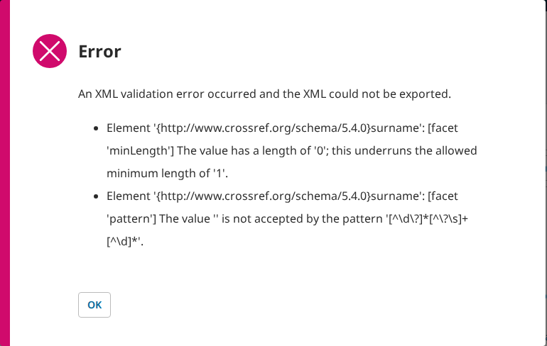
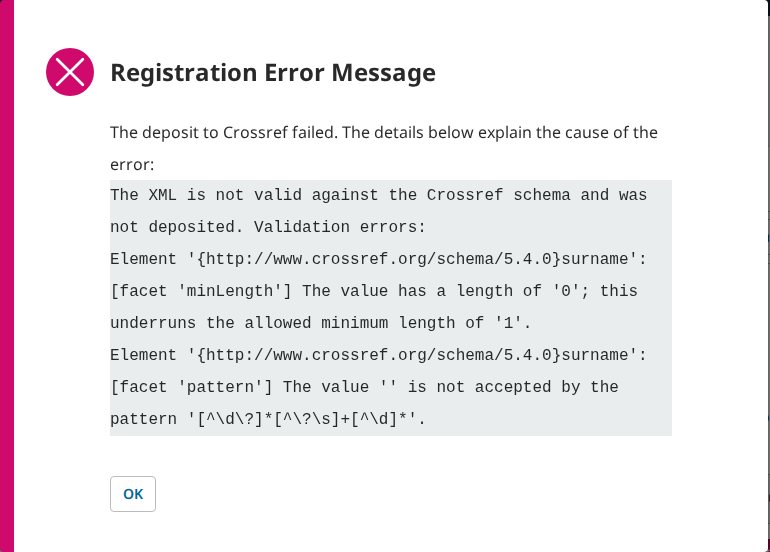
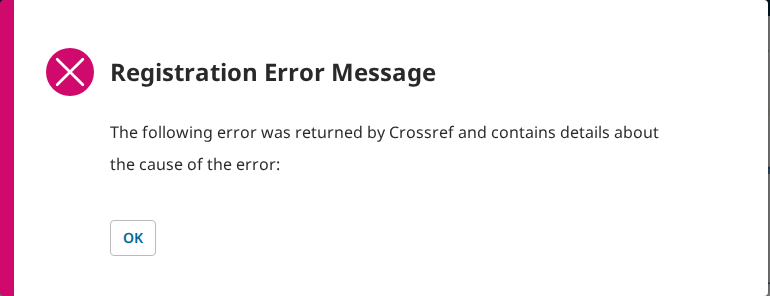
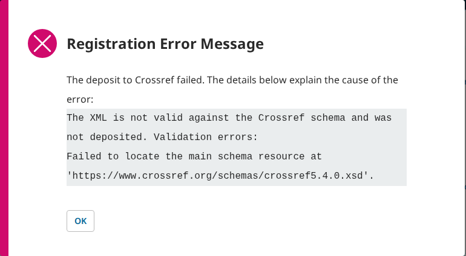

# The Crossref validation PRs do what the issue asks; round 2 takes the one suggested fix, and nothing is left

- **Severity** low
- **Effort** small
- **Kind** regression (in open PRs; nothing is merged), fixed in the PRs' round 2
- **Affects**
  - main: OJS, OPS, with the PRs (a press has no registration agency)
  - 3.5: none (no PR for 3.5)
  - 3.4: none (code; a deposit there ignores the validation errors)
  - 3.3: none (code; the same)
- **Introduced** `pkp/crossref-ojs#114` and `pkp/crossref-ops#73` for
  `pkp/pkp-lib#13507` · open PRs, round-1 heads
  [12574dea5f](https://github.com/pkp/crossref-ojs/pull/114/commits/12574dea5f586e8e88f5e6b3c9fe2535066fb847)
  and [b8d107ef10](https://github.com/pkp/crossref-ops/pull/73/commits/b8d107ef1096f0ac709772df831fd46ad82f795b) ·
  2026-10-13 · Bozana Bokan (bozana)
- **Upstream** `pkp/pkp-lib#13507` (open; it lists these PRs)
- **Tracked in** the ci-triage companion row `13507` (round 1's U45 A30 on the companion branch was deleted at round 2) · Temporary: delete once acted on
- **Checked** 2026-10-13, round 1 and round 2; 2026-10-14, round 3; the PR heads and their bases (the commits in Evidence)
- **Model** claude-opus-5-5

## Summary

**Update 2026-10-14, round 3.** Two small changes after code review:
pkp-lib#13508 (`b17fadae59`, rebased on `266505ecd8`, pkp-lib's tip)
now picks a message with `$error instanceof LibXMLError` and casts any
other entry to a string (it was `is_string()`), and ojs#5928
(`4b10e07fbf`, on `9f18cd1d46`) adds to the API documentation that
`api.dois.400.xmlExportFailed`'s `error` lists the validation errors
(`swagger-source.json`, still valid JSON). `git range-diff` against
round 2 shows nothing else: crossref-ojs#114 (`a49e612525`) is the same
patch rebased on the plugin's tip, ops#1447 (`d90f3d275d`) and omp#2506
(`a8c4ba6055`) only move their pointers, crossref-ops#73 and
ui-library#1016 are unchanged. Every list the helper is given (the
Crossref and DataCite plugins' and OJS's issue export) holds
`LibXMLError` objects from `exportXML()`, so the messages are the same.
Both sides were walked again from scratch at the round-3 heads and
bases, with the same results as round 2 (Evidence, "Round 3"), and
pkp-e2e's suites at the round-3 heads are red only on U03 S4 (K-12780).
**Nothing is left to change from the tests' side.**

**Update 2026-10-13, round 2.** The author took finding 1's fix into
both plugin PRs (crossref-ojs#114 at `477eec29d0`, crossref-ops#73 at
`8e82eda7cc`: the diff below, its comment reworded) and rebased
pkp-lib#13508 (`f1586e0d37`) and ojs#5928 (`12a0ae5bfb`) on the new tips
(`git range-diff`: the same patches; the new bases add only
pkp/pkp-lib#13504, reviewed and merged today); ops#1447 (`ce4b5111d7`)
and omp#2506 (`602f236674`) moved their pointers; ui-library#1016 is
unchanged. Both sides were walked again from scratch on the default
dataset (`side.sh base|head` at the new heads and bases). Everything below
holds at the round-2 heads, and finding 1 is gone: with Crossref's schema
out of reach the deposit is sent and the work registered, while an
invalid file is still refused before sending. pkp-e2e's suites at the
round-2 heads: under "The suites" in Evidence. **From the tests' side
nothing is left to change.**

PR review of the seven PRs of pkp/pkp-lib#13507 ("DOI export and deposit
do not show the Crossref XML validation errors"): pkp-lib#13508,
ui-library#1016, crossref-ojs#114, crossref-ops#73, ojs#5928, ops#1447
and the submodule-only omp#2506. The issue's own steps and its three
expectations were walked on PKP's default dataset before the change and
with it, on OJS and OPS, and the DOIs page's refusals on OJS, OMP and
OPS. A local stand-in for Crossref served Crossref's published schema
files and took the deposits, so nothing reached Crossref.

**The issue's three expectations hold on OJS and OPS** (the invalid
work is the issue's own: its first author's given name removed, which
gives the Crossref file an empty `surname`):

| The issue expects | Before (the bases) | With the PRs |
|---|---|---|
| "Export DOIs" shows the validation errors | No window at all; the 400 answer carried only "An XML validation error occurred…" | An "Error" window with that sentence over the list: the empty `surname`'s `minLength` and `pattern` messages |
| "Deposit DOIs" does not send invalid XML; "Error" with the validation errors | The file was sent; the (stand-in's) Crossref refusal showed under "View Error" | Nothing is sent; the work reads "Error", and "View Error" reads "The XML is not valid against the Crossref schema and was not deposited. Validation errors:" over the same two messages |
| libxml's buffer is cleared before each export | (no check on deposit, so no effect) | A valid work deposited right after an invalid one, by the same worker, is sent and registered; the same two calls in one PHP process without the new `libxml_clear_errors()` give the valid work the invalid one's two errors |





Beyond the issue's steps, two things improve as well:

- **Every refused bulk action now says why** (ui-library#1016). "Deposit
  DOIs" or "Export DOIs" with an unpublished work ticked, and any action
  confirmed with nothing ticked, leave an "Error" window with the
  server's reason on OJS, OMP and OPS, where the window used to close
  with no message. This is pkp-e2e's U45 A13
  ([pkp-e2e#234](https://github.com/jardakotesovec/pkp-e2e/issues/234)),
  which retires with these PRs. "DOI Updates Failed" ("Mark DOIs
  Registered" with an unpublished work) and the success notices are
  unchanged.
- **A deposit Crossref answers with failed records now shows Crossref's
  message.** Before, "View Error" showed the preamble and nothing under
  it; now Crossref's `<msg>` lines, then its whole answer, under the new
  preamble "The deposit to Crossref failed. The details below explain the
  cause of the error:".



**One finding** in round 1, small, with a one-condition fix tried on OJS
and OPS ([1](#finding-1)): a deposit was refused as "not valid" whenever
Crossref's schema could not be fetched, though the file was valid. Fixed
in round 2.

What this asks of whom:

- **The author** (@bozana): nothing more; finding 1's fix is in round 2.
- **pkp-e2e** (the merge session): the companion branch `13507` changes
  U45 S13 on OJS and OPS, which needs the "Error" window closed before
  going on. Without it ops#1447's own e2e check is red on S13; with it,
  green. It lands on pkp-e2e `main` when the app PRs merge.
- Whether the PRs merge as they are is the team's call.

pkp-e2e's whole suites ran at the PR heads in the three applications,
with the companion's tests: red only on the profile's email change (U03
scenario 4), a known red on `main` without the PRs (pkp-e2e's K-12780);
CI 38434584722 at the heads, under "The suites" in Evidence. The PRs add no unit test.

<a id="finding-1"></a>
## 1. A Crossref deposit is refused as "not valid" whenever Crossref's schema cannot be fetched (round 1; fixed in round 2)

Before a work is sent, its file is checked against Crossref's published
schema, which the install fetches from www.crossref.org each time.
crossref-ojs#114 and crossref-ops#73 now stop the deposit on any error
that check hands back. When the schema cannot be fetched, that error is
"Failed to locate the main schema resource at
'https://www.crossref.org/schemas/crossref5.4.0.xsd'.". So a valid file
is not sent, the work reads "Error", and "View Error" says "The XML is not
valid against the Crossref schema and was not deposited.". Before the
PRs, the same check failed the same way and the file was still sent;
Crossref checks it itself.



### Impact

- **Lost.** The deposit of every work while www.crossref.org cannot be
  reached from the server: the site down or slow, or a server whose
  firewall lets it reach Crossref's deposit service (api.crossref.org,
  doi.crossref.org) and not the website. "Deposit All" and the automatic
  deposit refuse every work the same way. The message blames the file,
  which is valid.
- **Who.** Journal and preprint server managers depositing with Crossref,
  at such a moment or on such a server.
- **Way round.** Deposit again once the site answers. A server that can
  never reach www.crossref.org has none.

Low: it needs the website out of reach while the deposit service is
not, and depositing again later works; the message sends the manager
looking for a fault in the metadata that is not there.

### Steps to reproduce

Preconditions: PKP's default dataset, OJS (OPS: the same with preprint
5); Crossref configured as in the issue (the Crossref plugin, a DOI
prefix, Crossref as the agency with a depositor name and email); the
server can reach api.crossref.org and not www.crossref.org (here: a local
stand-in answering 503 for the schema and taking the deposit; by hand,
`127.0.0.1 www.crossref.org` in the server's `/etc/hosts` gives the same
schema error, and the deposit then goes to Crossref's test or live
service).

1. Sign in as `dbarnes`. "DOIs": tick "Signalling Theory Dividends"
   (submission 1), "Bulk Actions" › "Assign DOIs".
2. Tick it again, "Bulk Actions" › "Deposit DOIs" › "Deposit DOIs".
3. Once the queue has run, expand the row and press "View Error".

**Expected.** The file is sent, as before the PRs; Crossref registers it
or answers with its own error.

**Observed.** Nothing reaches Crossref. The work reads "Error", and the
window reads "The deposit to Crossref failed. The details below explain
the cause of the error:" over "The XML is not valid against the Crossref
schema and was not deposited. Validation errors: Failed to locate the
main schema resource at
'https://www.crossref.org/schemas/crossref5.4.0.xsd'.".

### Cause

`CrossrefExportPlugin::exportAndDeposit()` (both plugin PRs) stops on any
entry in `$exportErrors`. `PubObjectsExportPlugin::exportXML()` fills it
with every libxml entry of level ERROR or FATAL, and that covers two
different things:

- a file that fails the schema: libxml's `XML_SCHEMAV_*` codes, 18xx
  (1801–1879; the empty `surname`: 1831 `minLength`, 1839 `pattern`);
- a schema that could not be loaded: code 1757
  (`XML_SCHEMAP_FAILED_LOAD`), level ERROR. An imported part that cannot
  be loaded (MathML, `xml.xsd`) is only a warning (3083), so it is
  already left out.

The schema is fetched by libxml on every export or deposit, through the
stream context pkp-lib sets with `libxml_set_streams_context()`
(`PKPContainer::settingProxyForStreamContext()`), so the `[proxy]`
settings apply.

### Proposed fix

Stop the deposit on schema validity errors only, and leave a schema that
could not be loaded to Crossref, as before. In both plugins'
`exportAndDeposit()`:

```diff
             $exportXml = $this->exportXML([$object], $filter, $context, $noValidation, $exportErrors);
-            if (!empty($exportErrors)) {
-                $messages = array_unique(array_map(fn (\LibXMLError $error) => trim($error->message), $exportErrors));
+            // Only a schema validity error (libxml's XML_SCHEMAV_* codes) says the file is invalid; a schema that
+            // could not be fetched (XML_SCHEMAP_FAILED_LOAD) leaves the check to Crossref, as before
+            $validityErrors = array_filter($exportErrors, fn (\LibXMLError $error) => $error->code >= 1800 && $error->code < 1900);
+            if (!empty($validityErrors)) {
+                $messages = array_unique(array_map(fn (\LibXMLError $error) => trim($error->message), $validityErrors));
```

Tried at the round-1 heads on OJS and OPS (`side.sh fix`, in git): the work of the steps
is sent and registered, and the invalid work is still refused with its
two messages. The trade-off: on a server that reaches nothing at all,
the PRs as they are turn the work "Error" (with the misleading message),
while with the fix the deposit is sent, fails to connect and the work
stays "Submitted" with a failed job, as before the PRs (pkp-e2e's U45
A18: a deposit that cannot connect stays "Submitted" with no error). A18
is better fixed where the connection fails. "Export DOIs" is still
refused while the schema cannot be fetched, as before the PRs, now with
the load error as its message.

## Other observations (no change asked)

- **DataCite export, several works** (code read): DataCite's
  `exportAsDownload()` calls `exportXML()` per work with one shared
  `$outputErrors`, which `exportXML()` overwrites only when a work has
  errors. With the new clear, the "Error" window lists the errors of the
  last failing work only, where before the PR the buffer held all of
  them. Not driven: the test installs reach no DataCite schema, and the
  issue is about Crossref.
- **DataCite deposit** still sends a file that fails its schema; the
  issue is about Crossref.

## Evidence

Round 3 (2026-10-14). Heads: pkp-lib `b17fadae59` (#13508 on
`266505ecd8`, pkp-lib's tip; `range-diff` against `f1586e0d37`: the
`LibXMLError` check and its `use` line), ui-library `47b565cb42`,
crossref-ojs `a49e612525` (#114 on `3a9f888d64`; `range-diff`: `=`),
crossref-ops `8e82eda7cc`, ojs `4b10e07fbf` (#5928 on `9f18cd1d46`; its
own commit adds the `swagger-source.json` note), ops `d90f3d275d` (#1447
on `35e128e878`), omp `a8c4ba6055` (#2506 on `119211f223`). Base: the
apps at those tips, `lib/pkp` at `266505ecd8`. The new pkp-lib base adds six
commits of pkp/pkp-lib#13283's PR set (the ORCID work; checking that
merge against its review is the companion's merge session) and
pkp/pkp-lib#13512, none read here (the daily sync's range). `side.sh
base|head` (walk, A13, A18) and `clear-control.sh`: every row of the
round-2 table below holds as it reads; one process, OJS `[(17, 2), (1,
0)]` with the clear and `[(17, 2), (1, 2)]` without, OPS `[(2, 2), (5,
0)]` and `[(2, 2), (5, 2)]`.

Round 2 (the evidence for the update at the top). Heads: pkp-lib
`f1586e0d37` (#13508 on `5d962d743e`, pkp-lib's tip; `range-diff` against
round 1: `=`), ui-library `47b565cb42` (unchanged), crossref-ojs
`477eec29d0` (#114 on `9b6a815ac4`), crossref-ops `8e82eda7cc` (#73 on
`16b97a1610`), ojs `12a0ae5bfb` (#5928 on `55914e80d4`, ojs's tip;
`range-diff` of its own commit: `=`), ops `ce4b5111d7` (#1447 on
`1bc3f78888`), omp `602f236674` (#2506 on `eb93813147`). Base: the apps at
those tips, `lib/pkp` at `5d962d743e`. Between round 1's base `a4f625a068`
and `5d962d743e` is pkp/pkp-lib#13504 alone (`c3a89aa3e3`, reviewed as
companion `13503`, merged today). The two plugin diffs from round 1's
heads are the proposed fix of finding 1, with the comment reworded. Walked
again, `side.sh base|head` (walk, A13, A18), facts in
`.reports/pr-13507/pr/` (round 1's moved to `.reports/pr-13507/r1/`):

| Step (OJS, OPS) | Base | Head |
|---|---|---|
| Export, invalid work | 400, no window | 400, "Error" with the two messages |
| Export, valid work | 200, a file | 200, a file |
| Deposit invalid + valid | both sent; "Error" (the stand-in's refusal) and "Registered" | only the valid one sent; "Error" with the two messages and "Registered" |
| Deposit, `failure_count` 1 | "Error", "View Error" empty | "Error", Crossref's message and answer |
| Deposit, schema 503 | sent, "Registered" | sent, "Registered" (round 1: not sent, "Error") |
| One process, invalid then valid | the valid work gets 2 errors (no clear) | the valid work gets none |
| No outbound at all (A18 walk) | sent, cURL error 7, failed job, "Submitted" | the same (round 1: not sent, "Error") |
| A13 walk (OJS, OMP, OPS) | refusals close with no window | "Error" window with the reason; "DOI Updates Failed" unchanged |

Round 1:

Commits. Heads: pkp-lib `cbaf79526c` (pkp/pkp-lib#13508, on `a4f625a068`,
pkp-lib's tip), ui-library `47b565cb42` (#1016 on `c9889f00b1`, the tip),
crossref-ojs `12574dea5f` (#114 on `9b6a815ac4`, the merge commit of
#113 with the same tree as `f358a32628`, ojs's pointer), crossref-ops
`b8d107ef10` (#73 on `16b97a1610`, likewise `4968397748`, ops's pointer), ojs `2458eead21` (#5928 on
`5c056f34b7`, ojs's tip), ops `bd864266eb` (#1447 on `1bc3f78888`, the
tip), omp `18f197514e` (#2506 on `eb93813147`, the tip); each app PR
moves `lib/pkp`, `lib/ui-library` (and the Crossref plugin) to the heads
above. Base: the three apps at those tips, `lib/pkp` at `a4f625a068`, the
other submodules as the tips point them. The PR ref carries no unreviewed
pkp-lib commit: between the apps' pointers and the base are
pkp/pkp-lib#13502 and #13506, both reviewed the same day.

Kept checks, `shared/playwright/checks/sync/pkp-lib-13508/`, each on a
freshly reset default dataset (`side.sh base|head`; round 1's `fix` side
and `fix-crossref-*.diff`, now in the PRs, are in git):

- `crossref-stub.js`: the Crossref stand-in behind the fleet's
  `[proxy]` (a copy of `crossref5.4.0.xsd` and the 24 files it includes or imports;
  `POST /v2/deposits` answered by the file: an empty `<surname>` gets a
  403 refusal in the shape the plugin reads, others `200-ok` or
  `200-failure`). The answers are written to the plugin's parser, not
  captured from Crossref.
- `walk.js`: the issue's steps on OJS (works 17, 1) and OPS (works 2,
  5, 6); step 10 is the finding.
- `buffer.php` and `clear-control.sh`: `exportXML()` on the invalid and
  then the valid work in one PHP process, with and without the
  `libxml_clear_errors()` line: OJS `[(17, 2), (1, 0)]` with it,
  `[(17, 2), (1, 2)]` without; OPS `[(2, 2), (5, 0)]` and
  `[(2, 2), (5, 2)]` (work, number of errors).
- `../../issues/bulk-action-refusal-no-message/walk.js` (U45 A13) and
  `../../issues/deposit-unreachable-agency-stays-submitted/walk.js` (U45
  A18), run by `side.sh` at both sides.

What each side showed (facts in `.reports/pr-13507/pr/` on the VM):

| Step | Base | Head | Head + fix |
|---|---|---|---|
| Export, invalid work (OJS, OPS) | 400, no window | 400, "Error" with the two messages | the same |
| Export, valid work | 200, a file | 200, a file | 200, a file |
| Deposit invalid + valid | both sent; invalid "Error" with Crossref's refusal; valid "Registered" | invalid not sent, "Error" with the two messages; valid sent, "Registered" | the same as head |
| Deposit, Crossref `failure_count` 1 | "Error", "View Error" empty | "Error", Crossref's message and answer | the same |
| Deposit, schema 503 (finding) | (by A18's walk: sent anyway) | not sent, "Error", "Failed to locate…" | sent, "Registered" |
| No outbound at all (A18 walk) | sent, cURL error 7, failed job, "Submitted" | not sent, "Error", "Failed to locate…" | sent, failed job, "Submitted" |
| A13 walk (OJS, OMP, OPS) | every refusal closes with no window | "Error" window with the server's reason | — |

libxml codes, read with PHP's `DOMDocument::schemaValidate()` against an
unreachable address (level 2, code 1757) and against the schema copy
(18xx for the invalid elements; 3083 warnings for imports).

The suites, round 3: CI
[38509383972](https://github.com/jardakotesovec/pkp-e2e/actions/runs/38509383972)
from the companion `13507` (rebased on pkp-e2e `main`) at the round-3 app
heads: red only on U03 S4 in OJS, OMP and OPS (K-12780), no flaky line.

The suites, round 2: CI
[38448308447](https://github.com/jardakotesovec/pkp-e2e/actions/runs/38448308447)
from the companion `13507` (rebased on pkp-e2e `main`) at the round-2 app
heads: red only on U03 S4 in OJS, OMP and OPS (K-12780), two flaky lines
green on their retry (OJS U09 S6, OMP U02 S6, both seen before).

The suites, round 1: CI
[38434584722](https://github.com/jardakotesovec/pkp-e2e/actions/runs/38434584722)
from the companion `13507` at the three app heads (bozana's forks):
red only on U03 S4 in OJS, OMP and OPS (pkp-e2e's K-12780, red on `main`),
one flaky line (OMP U02 S6, green on its retry, seen before). ops#1447's
own e2e check (run 38430978094, against pkp-e2e `main`) is red on U45 S13,
the test the companion changes, and on U03 S4. Its Cypress jobs
(38430977479) stop at "Installs the software" with the 120 s page-load
timeout; OPS `main`'s own run at the PR's base (38280086084) stops there
too, in four of its jobs.
