# The Eidos theme: bugs

- **Scope** bugs in the Eidos theme with Eidos enabled: things that are
  broken or wrong in what it already does. What Eidos lacks against the
  Default and ORE themes is in the companion report,
  `2026-10-14-eidos-theme-gap-analysis.md`. The first report,
  `2026-10-08-pkp-lib-13260.md`, covered what the same PRs break on
  installs that never switch to Eidos.
- **PRs** `pkp-lib#13260`, `ojs#5784`, `ui-library#972` and `crossref-ojs#107`,
  for `pkp-lib#13242`. Their heads are listed in Evidence and have not
  changed since the first report.
- **Checked** 2026-10-14, OJS only (Eidos is an OJS theme). Eidos was built
  from its own `package.json` and driven live in Chromium at 1280 px and
  390 px, on the Default theme as well for comparison. The code was read
  at the PR heads.
- **Model** claude-opus-5-5

Each item is marked **Driven** (seen on the live install) or **Code**
(read in the code only).

## Summary

Eidos is a complete, polished design for the pages it covers: the home
page blocks, the issue pages, the article page with its tabs, search,
categories, announcements, the About pages, login and registration.

1. **Two script injections.** A search link runs script for whoever opens
   it, and an author's response to reviewers runs script on the public
   article page.
2. **Pages and flows that break.**
   - Registration fails silently when a captcha or the site-wide privacy
     statement is on.
   - The masthead answers 500 when it lists a reviewer with an ORCID iD.
   - The site home page answers 500 on a fresh install, and is empty once
     it renders.
   - A full-issue PDF downloads instead of opening in the viewer.
3. **Wrong information on public pages.**
   - Every masthead person gets a fake, verified ORCID iD.
   - Editorial History has no dates.
   - The "outdated version" notice in the galley viewers is the wrong
     way round.
   - The metrics block shows only when a count is zero.
   - Peer review appears on articles that were never reviewed.

| # | Finding | Severity | Effort | Seen |
|---|---|---|---|---|
| [1](#finding-1) | Search page prints the query as HTML: a link runs script | high | small | Driven |
| [2](#finding-2) | Author's response to reviewers printed as HTML on the public article page | high | small | Driven |
| [3](#finding-3) | Registration fails silently with a captcha on, or at site level with the site-wide privacy statement on | high | small | Driven |
| [4](#finding-4) | Editorial Masthead answers 500 when it lists a reviewer with an ORCID iD | high | small | Driven |
| [5](#finding-5) | Every masthead and history person shows a fake, verified ORCID iD | high | small | Driven |
| [6](#finding-6) | Site home page: 500 without a site title, empty with one | medium | small | Driven |
| [7](#finding-7) | "Outdated version" notice inverted in the PDF and HTML viewers | medium | small | Driven |
| [8](#finding-8) | Full-issue PDF crashes the viewer template and downloads instead | medium | small | Driven |
| [9](#finding-9) | Peer review shown per journal, not per article; metrics block inverted | medium | small | Driven |
| [10](#finding-10) | Editorial History shows no dates; contact page prints template source | medium | small | Driven |
| [11](#finding-11) | Side effect on the Default theme: the comments sign-in link lost its anchor | low | small | Driven |
| [12](#finding-12) | A short issue description is faded out almost completely (home page "Current Issue (Summary)" block) | low | small | Driven |
| [13](#finding-13) | Home page Highlights: the image is cropped to fit its box; the previous arrow and the dots are hard to see on it | low | small | Driven |
| [14](#finding-14) | Page titles are escaped twice | low | small | Driven |
| [15](#finding-15) | Three raw translation keys | low | small | Driven |
| [16](#finding-16) | No `<main>` landmark on the home, article and sign-in pages | low | small | Driven |
| [17](#finding-17) | Two `<h1>` on every page when a logo is set | low | small | Driven |
| [18](#finding-18) | The header logo has no alternative text | low | small | Driven |
| [19](#finding-19) | The login password field has an invalid `autocomplete` value | low | small | Driven |
| [20](#finding-20) | The search field's label is the text `{$label}` | low | small | Code |
| [21](#finding-21) | Search breaks on installs without path info (the form drops its address's query string) | low | small | Driven / Code |
| [22](#finding-22) | The search date pickers show English month names in every language | low | small | Code |
| [23](#finding-23) | Supplementary galleys are never found in listings | low | small | Code |
| [24](#finding-24) | An article galley shows the issue's price | low | small | Code |
| [25](#finding-25) | Share links put the article address in unencoded | low | small | Code |
| [26](#finding-26) | The account menu's `aria-label` is unquoted | low | small | Code |
| [27](#finding-27) | The Comments and Metrics tabs break on an apostrophe in their data | low | small | Code |
| [28](#finding-28) | Comment dates are always shown as "… ago" | low | small | Code |
| [29](#finding-29) | The "Latest Announcement" block stays empty without saying why | low | small | Driven |
| [30](#finding-30) | PHP warnings on nearly every page | low | small | Driven |
| [31](#finding-31) | Colour options go unchecked into the page's styles (manager-entered) | low | small | Driven |
| [32](#finding-32) | The issue summary decodes escaped text into markup (manager-entered) | low | small | Driven |
| [33](#finding-33) | `npm ci` fails on the theme | low | small | Driven |

**Security-related:** four findings.
- [1](#finding-1): a search link runs script.
- [2](#finding-2): an author's response to reviewers runs script on the
  public article page.
- [31](#finding-31) and [32](#finding-32): manager-entered colour values
  and issue descriptions can inject script. They are low because only a
  manager can enter them.

Eidos is unreleased, so per the security policy all four are ordinary
findings with the `security` label.

<a name="finding-1"></a>
## Finding 1: the search page prints the query as HTML

- **Severity** high · **Effort** small · **Security** unreleased · Driven

**What happens.** A search address carrying markup in `query` puts that
markup into the results line, and a script in it runs. Anyone can
receive such a link, an editor or a manager included.

**Steps.** Open
`/index.php/<journal>/search/search?query=zz`.
`window.__q` is `1`, and an injected `` sits in "Showing 1-1 articles
matching the phrase …". The Default theme prints the query as text.

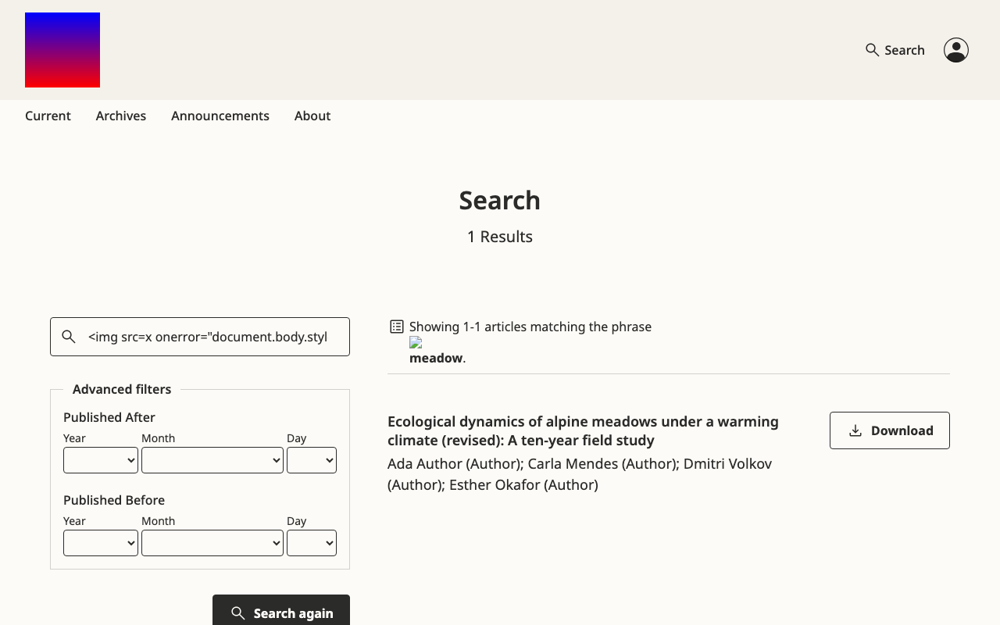

**Cause.** `plugins/themes/eidos/templates/frontend/pages/search.blade:61`
and `:76` print `__('plugins.themes.eidos.search.noMatches' | …showing…,
['phrase' => $query])` with `{!! !!}`. `$query` is the raw request value.
`:23` also builds `$urlPattern` from raw `$_SERVER['REQUEST_URI']`, and
`components/pagination-custom.blade:75` prints it unescaped in an `href`.

**Fix.** Escape the phrase before it goes into the translation, as in
`['phrase' => e($query)]`, and keep `{!! !!}` only for the markup the locale
adds. Print `$urlPattern` with `{{ }}`, and build it from the route rather
than `REQUEST_URI`.

<a name="finding-2"></a>
## Finding 2: an author's response to reviewers runs on the public article page

- **Severity** high · **Effort** small · **Security** unreleased · Driven

**What happens.** With open review, the Peer Review tab shows the
author's response under each round. The response is printed as HTML
without cleaning, so markup the author typed runs for every reader.

**Steps.** On a published article with public, confirmed reviews, store
an author response holding ``.
Open the article's Peer Review tab and press "Author Response".
`window.__authorXss` is `1`.

**Cause.** `components/article/tab-peer-review.blade:154` prints
`{!! $round['authorResponse']['response'] !!}`. Every other review field
in Eidos goes through `ViewHelper::sanitizeHtml()`, and ORE's Vue
component cleans the response too (`v-strip-unsafe-html`).

**Also wrong here.** The response's header gives the date of the round's
last review, not of the response (`:110` uses the leftover
`$review['dateCompleted']`). In the screenshot it reads "June 1, 2025"
above a response dated October 14, 2026.

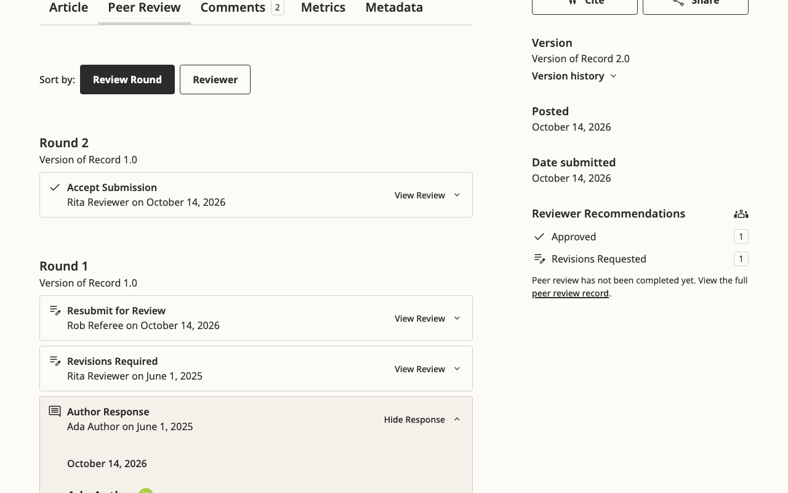

**Fix.** Use `{!! ViewHelper::sanitizeHtml(...) !!}`, and take the date from
`$round['authorResponse']['createdAt']`.

**Note on the first report.** Finding 7 there proposes that
`ReviewRoundAuthorResponseResource` return the response as a locale map,
which the editor's window needs. With that fix in place this template
prints "Array". So the Eidos fix must pick the localized value as well
as sanitize it.

<a name="finding-3"></a>
## Finding 3: registration fails silently under two common settings

- **Severity** high · **Effort** small · Driven

**What happens.**
- **With a captcha on registration** (`[captcha] altcha = On` with the
  default `altcha_on_register = on`, or reCAPTCHA with
  `captcha_on_register`): Eidos's registration form shows no captcha
  widget. The server refuses the form every time, and the page comes
  back with the passwords cleared and no message, so nobody can register
  and nobody is told why. With ALTCHA off the same form registers. On
  the Default theme, with ALTCHA on, the widget shows and registration
  succeeds.
- **At site level with `sitewide_privacy_statement = On`** and a site
  privacy statement: the form has no site consent box. It is refused the
  same silent way. On the Default theme the box `privacyConsent[0]` shows
  and registration succeeds.

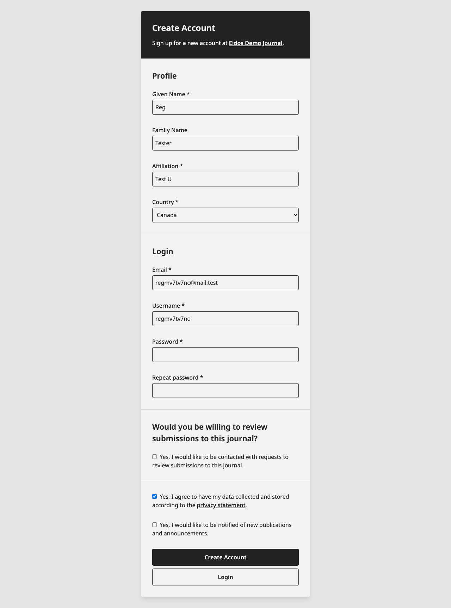

Field errors do show ("The selected username is already in use…"). What
is missing is the form-level error, so these two refusals are invisible.

**Cause.** `frontend/pages/userRegister.blade` has no reCAPTCHA or ALTCHA
block; `userLogin.blade:75-81` has both. The consent boxes sit under
`@if ($currentContext)` (`:277`), and nothing prints the form's general
errors.

**Fix.**
- Add the captcha blocks from `userLogin.blade`.
- Add the site consent box when `$enableSiteWidePrivacyStatement` is set,
  as core `userRegister.tpl:136-148` does.
- Print the form's error list at the top.

<a name="finding-4"></a>
## Finding 4: the Editorial Masthead answers 500 when it lists a reviewer with an ORCID iD

- **Severity** high · **Effort** small · **Crash** server · Driven

**What happens.** With the masthead's reviewer list on
("enableEnrollmentMastheadReviewers") and one of last year's reviewers
holding an ORCID iD, the whole page answers 500.

**Server log.**

```
Call to a member function getData() on string (View: …/editorialMasthead.blade)
```

**Cause.** `frontend/pages/editorialMasthead.blade:52` calls
`$reviewer->getData('orcid')->getData('orcid')`, but `getData('orcid')`
is a string.

**Fix.** Use `$reviewer->getData('orcid')` directly, and
`$reviewer->hasVerifiedOrcid()` for the badge.

<a name="finding-5"></a>
## Finding 5: every masthead and history person shows a fake, verified ORCID iD

- **Severity** high · **Effort** small · Driven

**What happens.** On Editorial Masthead and Editorial History every
person has a green ORCID iD icon linking to `https://orcid.org/123454646`,
whether or not they have an ORCID. The Default theme shows an iD only
for verified ones.

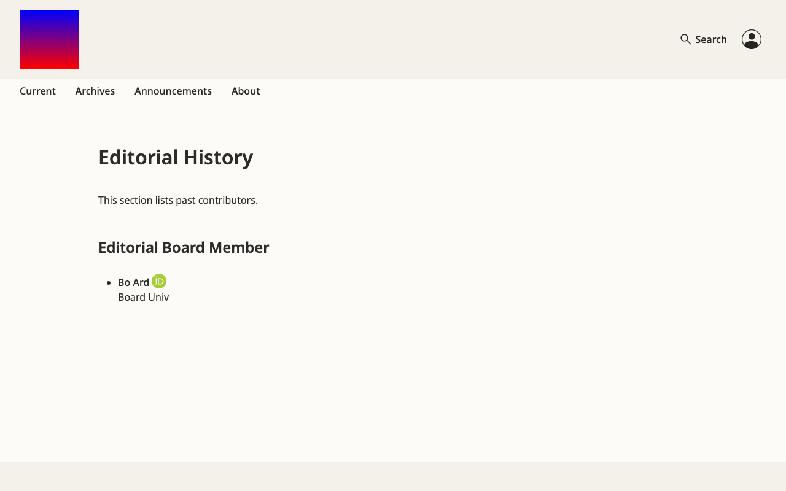

**Cause.**
- `components/masthead-user.blade:10` hard-codes
  `$orcid = 'https://orcid.org/123454646'`.
- `editorialMasthead.blade:18` and `editorialHistory.blade:22` pass
  `hasVerifiedOrcid="$mastheadUser[…]->hasVerifiedOrcid()"` without the
  `:` binding, so the attribute is a non-empty string and always true.

**Fix.** Pass the user's iD (`:orcid="$user->getData('orcid')"`), bind
`:hasVerifiedOrcid`, and show the icon only when both are set.

<a name="finding-6"></a>
## Finding 6: the site home page answers 500 without a site title, and is empty with one

- **Severity** medium · **Effort** small · **Crash** server · Driven

**What happens.**
- With Eidos as the site's theme, the site home page answers 500 while
  the site has no title. That is the state a fresh install is in: neither
  PKP's test dataset nor the campaign's own install stores a site title.
  The admin can fix it by saving a Site Name.
- Once a title exists, the page renders a header, an empty body and the
  footer, with no list of journals, although two journals are enabled.

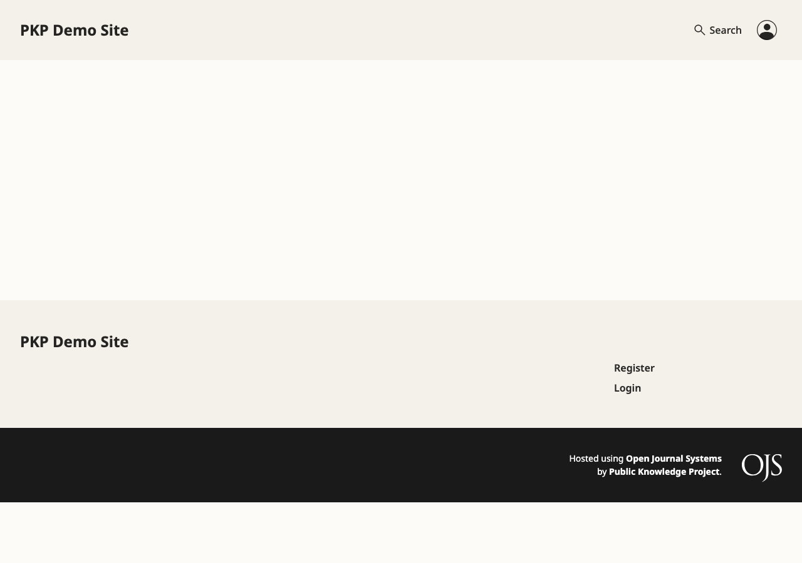

**Cause.**
- `EidosTheme.php:218-224` `contextName(): string` returns
  `getSite()->getLocalizedTitle()`, which is null. The resulting
  TypeError aborts `addTemplateData`, so `$getBlocks` is never shared and
  `homepage-blocks/index.blade` fails.
- The site uses `Options::HOMEPAGE_BLOCKS_DEFAULT` (announcement, about,
  how-to-submit, issue-toc), which holds nothing a site can show. The
  journals block `homepage-blocks.contexts` is never on by default.

**Fix.** Return `?? ''` in `contextName()`, and give the site its own
default block list starting with `homepage-blocks.contexts`.

<a name="finding-7"></a>
## Finding 7: the "outdated version" notice is the wrong way round in the galley viewers

- **Severity** medium · **Effort** small · Driven

**What happens.** With two published versions:
- The **latest** version's PDF and HTML galleys say "This is an outdated
  version published on October 14, 2026. Read the most recent version."
- The **old** version's galleys say nothing.

The article pages themselves are right, and so is the Default theme in
both places.

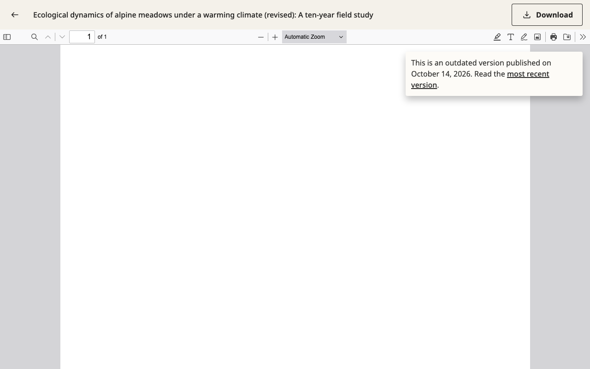
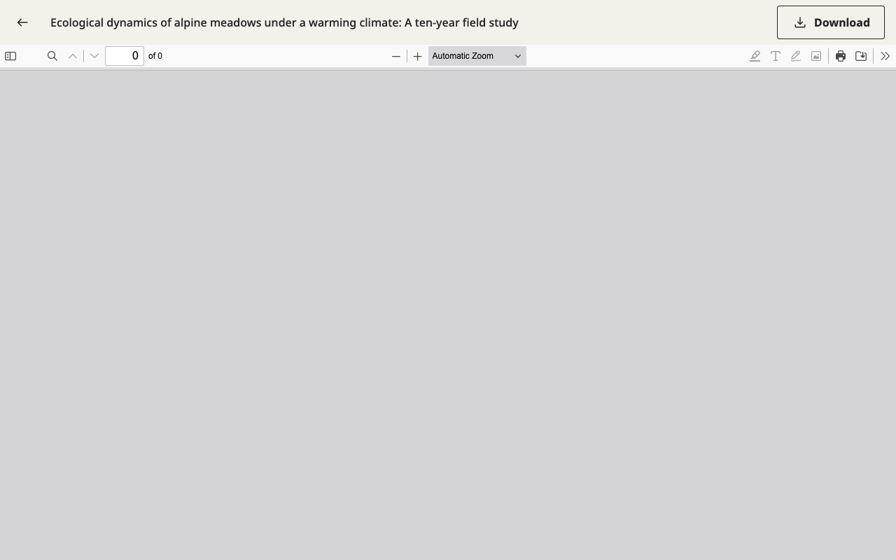
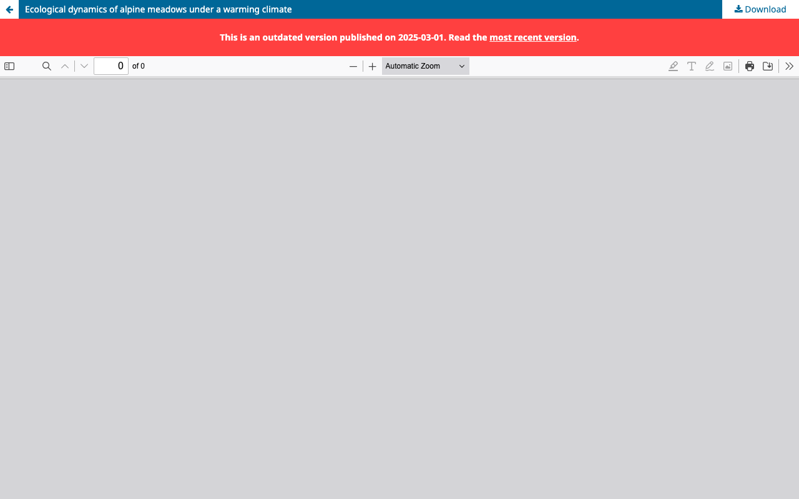

**Cause.** `!$isLatestPublication ? '' : notice` in
`templates/plugins/generic/pdfJsViewer/templates/display.blade:7-14` and
`htmlArticleGalley/templates/display.blade:24-31`.

**Fix.** Swap the two branches.

<a name="finding-8"></a>
## Finding 8: a full-issue PDF crashes the viewer template

- **Severity** medium · **Effort** small · Driven

**What happens.** On an issue with a full-issue PDF galley, the galley
link downloads the file instead of opening the PDF viewer, as it does on
the Default theme.

**Server log.**

```
Call to a member function getLocalizedFullTitle() on null
  (View: …/eidos/templates/plugins/generic/pdfJsViewer/templates/display.blade)
Plugin APP\plugins\generic\pdfJsViewer\PdfJsViewerPlugin failed to handle the hook IssueHandler::view::galley
```

**Cause.** The template reads `$publication` and `$galleyPublication`,
which the plugin's issue callback does not assign.

**Fix.** Branch on `$issue` in the template, or add an issue variant of
the template.

<a name="finding-9"></a>
## Finding 9: peer review shown per journal, not per article; metrics block inverted

- **Severity** medium · **Effort** small · Driven

**Peer review on every article.**
- **What happens.** The Peer Review tab and the sidebar's "Reviewer
  Recommendations" show whenever the journal's default review visibility
  is on, even for an article that was never reviewed. That article
  reads "Peer review has not been completed yet" and offers a "full peer
  review record" that says "Peer review data is not yet available". ORE
  hides all of it for an item with no public review activity.
- **Cause.** `components/article/tabs.blade:12` and core
  `metadata-blocks/peer-review.blade:1` test
  `$currentContext->getData('defaultReviewPublicVisibility')`.

**Metrics block inverted.**
- **What happens.** With "Metrics" in the sidebar, an article with 103
  views and 54 downloads shows no metrics block, while articles with no
  usage show "0 views and 0 downloads".
- **Cause.** `components/metadata-blocks/metrics.blade:1` reads
  `@if (!$metricsViews || !$metricsDownloads)`.

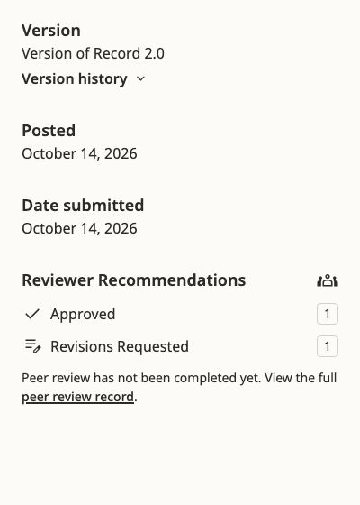
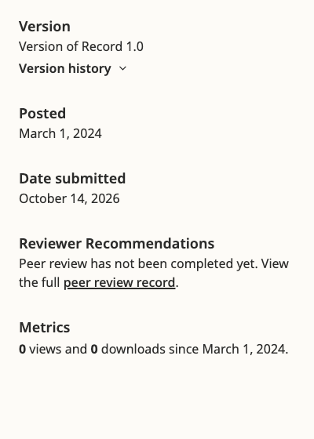

**Fix.** Gate the peer-review UI on the article's public review rounds.
Invert the metrics condition to `@if ($metricsViews || $metricsDownloads)`,
and default both variables to 0 in `classes/MetadataBlocks.php:38-41`.

<a name="finding-10"></a>
## Finding 10: Editorial History shows no dates; the contact page prints template source

- **Severity** medium · **Effort** small · Driven

**Editorial History has no dates.**
- **What happens.** A board member who served 2023–2025 is listed with no
  years. The Default theme shows "2023 – 2025" (screenshots under finding
  6 and below).
- **Cause.** `editorialHistory.blade:24-25` reads
  `$mastheadUser['dateStart' | 'dateEnd']`, but the handler supplies
  `services => [[dateStart, dateEnd], …]`
  (`lib/pkp/pages/about/AboutContextHandler.php:180-193`). Each person
  also logs two "Undefined array key" warnings.

**The contact page prints template source.**
- **What happens.** With a principal contact affiliation set, the page
  prints the literal text `{!! ViewHelper::sanitizeHtml($contactAffiliation) }}`
  instead of the affiliation.
- **Cause.** `frontend/pages/contact.blade:25` opens with `{!!` and closes
  with `}}`.

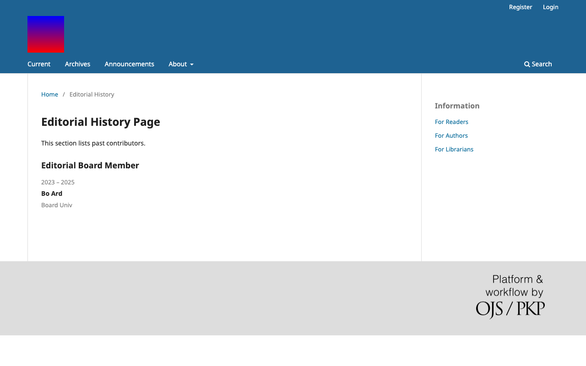
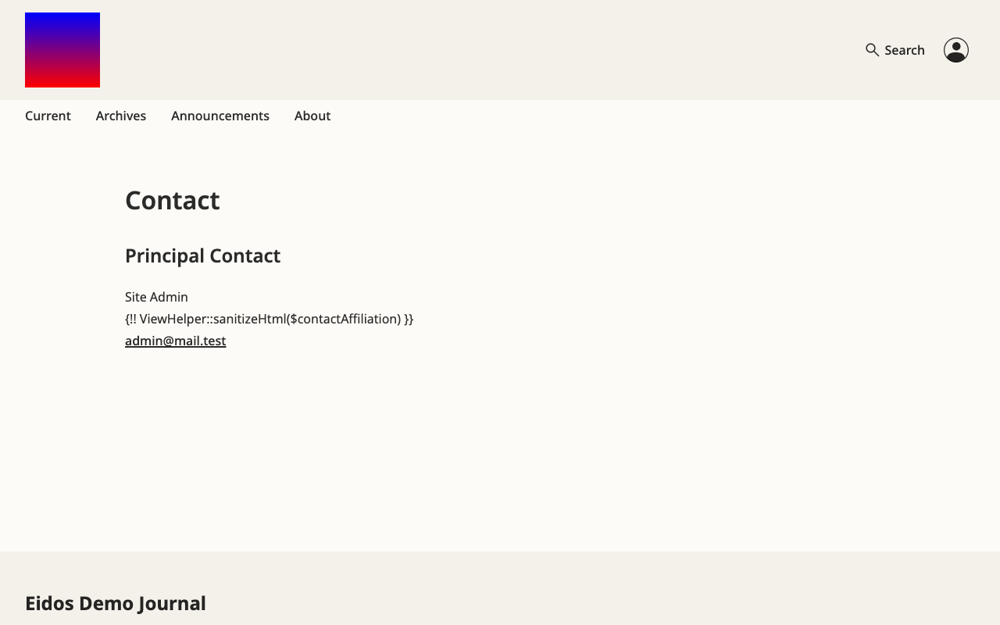

<a name="finding-11"></a>
## Finding 11: side effect on the Default theme, the comments sign-in link

- **Severity** low · **Effort** small · Driven

On the Default theme, "Sign in to leave a comment" now returns the
reader to `…/article/view/21?section=comments`, where it used to return
to `…#public-comments`. The Default theme has no `section` tab, so after
signing in the reader lands at the top of the article instead of at the
comments.

**Cause.** `lib/pkp/classes/components/UserCommentComponent.php:153` in
the PR (was `:141`, `'#public-comments'`).

**Fix.** Let the theme supply the return anchor, or keep both, as in
`?section=comments#public-comments`.

<a name="finding-12"></a>
## Finding 12: a short issue description is faded out almost completely

- **Severity** low · **Effort** small · Driven (screenshot from the maintainer)

**What happens.** On the home page's "Current Issue (Summary)" block,
the issue description fades into the background at its bottom edge, to
hint that longer text is cut off. The fade is always drawn, so a
one-line description ("The current issue of the Journal of Public
Knowledge.") sits entirely inside it and is barely readable.

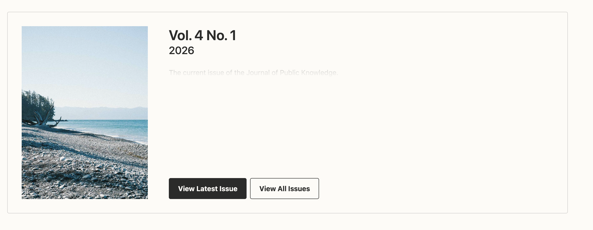

**Cause.** `plugins/themes/eidos/src/css/components/issue-summary.css:44-59`.
`.issue-summary-description:after` is placed at `top: 100%`, right
under the text, with `box-shadow: 0 -2rem 2rem var(--color-page-background)`.
The shadow covers the bottom 3 to 4 rem of the description whatever its
length. The fade only belongs when the text reaches `max-height`
(16 rem, or 9.5 rem from 1024 px).

**Fix.** Draw the fade only when the text overflows. For example, add a
class from JavaScript when `scrollHeight > clientHeight`, or replace the
fade with `line-clamp`, which cuts and adds an ellipsis only when needed.

<a name="finding-13"></a>
## Finding 13: the Highlights image is cropped to fit its box

- **Severity** low · **Effort** small · Driven (screenshot from the maintainer)

**What happens.**
- On the home page's Highlights slider, the image does not fit its box.
  It is scaled to fill the box and cut at the edges, so an image with
  text loses its first letters ("Two versions, two rounds of open
  review" reads "wo versions, wo rounds of pen review").
- On the same slide, the "previous" arrow and the slide dots sit on the
  image in the block text colour (dark by default), so on a dark image
  they are barely visible.

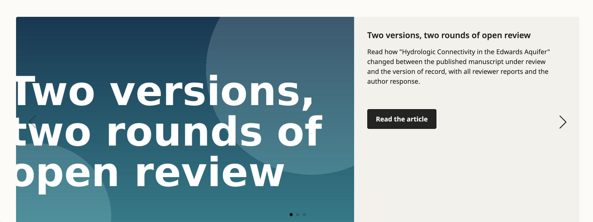

**Cause.** `plugins/themes/eidos/src/css/components/homepage-blocks/highlights.css`.
- `.swiper-slide-image` has `object-fit: cover` and `aspect-ratio: 1.5 / 1`.
- From 1280 px the slide is a `3fr 2fr` grid capped at `max-height: 32rem`,
  and the image gets `align-self: stretch`. So the image fills a box
  whose shape changes with the window width, and cover crops whatever
  does not match. Nothing tells the manager what shape the image should
  be: the Highlights form only says "Image".
- The arrows and dots take `--swiper-theme-color: var(--color-block-text)`
  and sit over the image half of the slide.

**Fix.**
- Keep the image's own shape: `object-fit: contain`, or a fixed
  `aspect-ratio` without `stretch`. Otherwise state the expected aspect
  ratio and size next to the upload field.
- Give the arrows and dots a contrasting background, or place them
  outside the image.

<a name="finding-14"></a>
## Finding 14: page titles are escaped twice

- **Severity** low · **Effort** small · Driven

**What happens.** A title holding `&` shows as "Neural networks
&amp;amp; species identification" in the browser tab, in bookmarks and in
search engines' results. The same happens to `<`, `>` and quotes, and to
the h1 of pages built on the basic layout (About, Contact and others).

**Where.** Pages pass the title as an attribute,
`<x-layout.index title="{{ … }}">`, which escapes it once, and the
layout prints it with `{{ }}` again:
- `components/layout/index.blade:40`, `<title>{{ $title }}</title>`
- `components/layout/galley.blade:16`
- `components/system/layout.blade:16`
- `components/layout/basic.blade:22`, the h1
- `components/system/form-input.blade:15`, the form labels (a French
  label with an apostrophe would show `&#039;`)

**Fix.** Pass the raw value with a bound attribute,
`:title="$article->getLocalizedFullTitle()"`, so it is escaped once when
printed.

<a name="finding-15"></a>
## Finding 15: three raw translation keys

- **Severity** low · **Effort** small · Driven (first two)

**What happens.**
- **Every page:** the mobile menu button's hidden label is
  `##plugins.themes.eidos.menu##`, which screen readers read aloud.
- **A subcategory's page:** the "back to the parent category" link's
  `aria-label` is `##plugins.themes.individualizeTheme.backToTitle##`.
- **Announcements with none published:** the notice text is the key
  `plugins.themes.individualizeTheme.announcements.none`.

**Where.** `components/header/mobile.blade:32`,
`frontend/pages/catalogCategory.blade:40`,
`frontend/pages/announcements.blade:9`. The last two keys come from
another theme ("Individualize") and are in no locale file.

**Fix.** Add `plugins.themes.eidos.menu` to `locale/en/locale.po`, and
give the other two Eidos keys (or reuse core ones such as
`announcement.noneExist`).

<a name="finding-16"></a>
## Finding 16: no `<main>` landmark on the home, article and sign-in pages

- **Severity** low · **Effort** small · Driven (axe `landmark-one-main`)

**What happens.** Screen-reader users cannot jump to the main content
with the landmark shortcut on the home page, article pages, login,
register and lost-password pages. The Default theme passes this check on
all of them, and so do Eidos's About and category pages.

**Where.**
- `frontend/pages/indexJournal.blade:5` uses
  `<div class="page-container page-homepage" id="skip-to-main">`.
- `frontend/pages/article.blade:11` uses `<article … id="skip-to-main">`.
- `components/system/layout.blade` (login, register, lost password) has
  no `<main>`.

`components/layout/basic.blade:16` and `catalogCategory.blade:17` do use
`<main>`.

**Fix.** Wrap each page's content in
`<main id="skip-to-main">`, with the `<article>` inside it.

<a name="finding-17"></a>
## Finding 17: two `<h1>` on every page when a logo is set

- **Severity** low · **Effort** small · Driven

**What happens.** With a header logo, every page has a hidden `<h1>`
with the site's name before the page's own `<h1>`, so screen readers
announce two top headings. On a journal page it even reads the site
name, not the journal's.

**Where.** `components/header/mobile.blade:11-13`:
`<h1 class="sr-only">{{ $siteName }}</h1>`. The desktop header uses a
`<div class="sr-only">` with `$contextName` (`desktop.blade:47-49`).

**Fix.** Use the desktop header's markup: a `<div>` or `<span>` with
`$contextName`.

<a name="finding-18"></a>
## Finding 18: the header logo has no alternative text

- **Severity** low · **Effort** small · Driven

**What happens.** The logo's alt text, entered by the manager when
uploading it, is never used. The desktop logo has no `alt` at all, and
the mobile logo's `alt` is always empty.

**Where.**
- `components/header/desktop.blade:50-51`: ``,
  with no `alt`.
- `components/header/mobile.blade:15` reads
  `$displayPageHeaderLogo['alt']`, but the stored key is `altText` (the
  Default theme's `header.tpl:55` reads `altText`).

**Fix.** On both images:
`alt="{{ $displayPageHeaderLogo['altText'] ?? $contextName }}"`.

<a name="finding-19"></a>
## Finding 19: the login password field has an invalid `autocomplete` value

- **Severity** low · **Effort** small · Driven (axe `autocomplete-valid`)

**What happens.** Password managers and browsers may not offer to fill
the saved password on Eidos's login page.

**Where.** `frontend/pages/userLogin.blade:53`: `autocomplete="password"`.

**Fix.** `autocomplete="current-password"`. The username field takes
`autocomplete="username"`.

<a name="finding-20"></a>
## Finding 20: the search field's label is the text `{$label}`

- **Severity** low · **Effort** small · Code

**What happens.** Screen readers announce the search box on the search
page and in the header as "{$label}".

**Where.** `components/search-form.blade:11-13`:

```blade
<label for="search-input" class="sr-only">
    {$label}
</label>
```

A Smarty leftover, printed as text.

**Fix.** `{{ __('common.search') }}`, or a `label` prop passed by the
callers.

<a name="finding-21"></a>
## Finding 21: search breaks on installs without path info

- **Severity** low · **Effort** small · Driven (the warnings), Code (the consequence)

**What happens.**
- **With the default setup, nothing is lost.** The query and the date
  filters are ordinary form fields and survive a new search; the
  maintainer confirmed it on another instance. Each search logs two
  warnings: "Undefined variable $formUrlParameters" and "foreach()
  argument must be of type array|object".
- **On an install with `disable_path_info = On`**, the search form's
  address carries the journal and page in its query string
  (`index.php?journal=…&page=search&op=search`). A GET form drops that
  query string when it submits, so the search leaves the journal. The
  hidden fields the loop was meant to write are what keeps those
  parameters. Not driven.

**Where.** `components/search-form.blade:6-8` loops `$formUrlParameters`,
which nothing assigns. The Default theme builds it from the form's own
address (`templates/frontend/pages/search.tpl:35-38`):

```smarty
{assign var=formUrlParameters value=[]}
{$smarty.capture.searchFormUrl|parse_url:$smarty.const.PHP_URL_QUERY|default:""|parse_str:$formUrlParameters}
{foreach from=$formUrlParameters key=paramKey item=paramValue}
```

ORE does the same in `searchComponent.blade:19-20,130`.

**Fix.** Build the variable before the loop, as ORE does:

```php
$searchFormUrl = ViewHelper::url(['page' => 'search', 'op' => 'search']);
$formUrlParameters = [];
parse_str(parse_url($searchFormUrl, PHP_URL_QUERY) ?? '', $formUrlParameters);
```

<a name="finding-22"></a>
## Finding 22: the search date pickers show English month names in every language

- **Severity** low · **Effort** small · Code

**What happens.** In "Published After" and "Published Before" the month
list reads Jan, Feb, … whatever the reader's language. The Default
theme's pickers are translated.

**Where.** `lib/pkp/templates/components/date-select.blade:22`:
`date('M', strtotime('2020-' . $i . '-01'))`. PHP's `date()` is always
English.

**Fix.** Use the locale's month names, for example
`\Carbon\Carbon::create(2020, $i)->locale(Locale::getLocale())->isoFormat('MMM')`,
or the same source the Default theme's date picker uses.

<a name="finding-23"></a>
## Finding 23: supplementary galleys are never found in listings

- **Severity** low · **Effort** small · Code

**What happens.** With article galleys shown in the table of contents
(the theme's "Issue Table of Contents" option), a supplementary galley,
such as a dataset uploaded as a supplementary file, is never listed as
supplementary.

**Where.** `components/article-summary.blade:77`:
`in_array($galley->getId(), $supplementaryFileGenreIds)` compares a
**galley id** with **genre ids**. Line 75 also calls
`$galley->getFile()->getGenreId()` without checking that the galley has
a file.

**Fix.** `in_array($galley->getFile()?->getGenreId(), $supplementaryFileGenreIds)`,
as line 75 does for primary files.

<a name="finding-24"></a>
## Finding 24: an article galley shows the issue's price

- **Severity** low · **Effort** small · Code

**What happens.** On a subscription journal with per-article purchase,
a locked article galley shows the price set for buying a whole issue.

**Where.** `components/galley-link.blade:49-53`:
`$galleyContext->getSetting('purchaseIssueFee')` for every galley.
`$galleyContext` itself is never assigned (only `$galleyContextPath` is,
line 18), so today the price never shows at all.

**Fix.** Use `purchaseArticleFee` for article galleys and
`purchaseIssueFee` for issue galleys, as the Default theme's
`galley_link.tpl` does, and assign the context.

<a name="finding-25"></a>
## Finding 25: share links put the article address in unencoded

- **Severity** low · **Effort** small · Code

**What happens.** The Facebook, X, Reddit, LinkedIn, Telegram and email
share links put the article's address into their own query string as
is. An address carrying its own query or `&` breaks the share link.

**Where.** `components/share-links.blade:8-50`: the title is
`urlencode()`d (`$urlEncodedTitle`), the address `{$url}` is not.

**Fix.** `$urlEncodedUrl = urlencode($url);` next to the title, and use it
in every link.

<a name="finding-26"></a>
## Finding 26: the account menu's `aria-label` is unquoted

- **Severity** low · **Effort** small · Code

**What happens.** In a language whose word for "Account" has a space,
the button's label is cut at the first word, and the rest becomes stray
attributes.

**Where.** `components/header/utility-menu.blade:15`:
`aria-label={{ __('plugins.themes.eidos.account') }}`.

**Fix.** `aria-label="{{ __('plugins.themes.eidos.account') }}"`.

<a name="finding-27"></a>
## Finding 27: the Comments and Metrics tabs break on an apostrophe in their data

- **Severity** low · **Effort** small · Code

**What happens.** The Comments and Metrics tabs hand their data to Vue
inside a single-quoted attribute. An apostrophe anywhere in that data (a
translated text such as French "d'un", or a version name) ends the
attribute early, and the tab fails to render.

**Where.** `components/article/tab-comments.blade:3-7` and
`tab-metrics.blade:3-7`:

```blade
$json = json_encode($userCommentsInitConfig);
<pkp-comments v-bind='{!! $json !!}'></pkp-comments>
```

The `{{`/`}}` replacements alter the data too.

**Fix.** `v-bind='@json($userCommentsInitConfig)'`, as the Cite button
already does (`components/article/sidebar.blade:42`). Blade's `@json`
escapes the apostrophe.

<a name="finding-28"></a>
## Finding 28: comment dates are always shown as "… ago"

- **Severity** low · **Effort** small · Code

**What happens.** A comment from last year still shows "11 months ago"
instead of switching to a short date after a week, as intended.

**Where.** ui-library `src/frontend/components/PkpComments/usePkpCommentsStore.js:131-133`
(new in ui-library#972):

```js
const msWeek = 605800000;
const moreThanWeekOld = new Date().getTime() - dateTime.toTimeString() > msWeek;
```

`toTimeString()` is text, so the subtraction is `NaN` and the test is
always false. A week is also 604800000 ms.

**Fix.** `Date.now() - dateTime.getTime() > 604800000`.

<a name="finding-29"></a>
## Finding 29: the "Latest Announcement" block stays empty without saying why

- **Severity** low · **Effort** small · Driven

**What happens.** "Latest Announcement" is the first home page block
Eidos turns on by default. With announcements enabled and published, it
shows nothing until the manager also fills in Settings › Website ›
Announcements › "Display on homepage" with a number. Nothing on the
theme's options says so.

**Where.** `lib/pkp/pages/index/PKPIndexHandler.php:42` loads
announcements only when `numAnnouncementsHomepage` is set, and
`lib/pkp/templates/components/homepage-blocks/announcement.blade:1`
shows the block only when some were loaded.

**Fix.** Either load the latest announcement for the block whenever it
is ticked, or say in the option's description that it needs "Display
on homepage".

<a name="finding-30"></a>
## Finding 30: PHP warnings on nearly every page

- **Severity** low · **Effort** small · Driven

**What happens.** Eidos's templates read variables that their callers
do not always pass, so most pages write "Undefined variable" or
"Undefined array key" warnings to the server log. Production logs fill
up, and real errors are harder to see.

Seen in the walk:

| Variable | Template |
|---|---|
| `$description` | `components/layout/index.blade`, `layout/basic.blade`, `layout/galley.blade`, `system/layout.blade` |
| `$head`, `$downloadUrl` | `components/layout/galley.blade`, `system/layout.blade` |
| `$subtitle` | `components/layout/basic.blade` |
| `$class`, `$labelledBy` | `components/galley-link.blade` |
| `$pubIdPlugins` | `components/issue-toc.blade` |
| `$primaryFileGenreIds` | `components/article-summary.blade` |
| `$citation` | `components/article/sidebar.blade` |
| `$error`, `$recaptchaPublicKey`, `$altchaEnabled` | `frontend/pages/userLogin.blade` |
| `$error`, `$altchaEnabled`, `$source` | `frontend/pages/userLostPassword.blade` |
| `privacyConsent` | `frontend/pages/userRegister.blade` |
| `dateEnd` | `frontend/pages/editorialMasthead.blade` |

**Where.** The components declare no `@props`, so an attribute a caller
leaves out is simply undefined.

**Fix.** Declare optional props with defaults, as in
`@props(['description' => null, 'head' => null])`, or read them with
`?? null`.

<a name="finding-31"></a>
## Finding 31: colour options go unchecked into the page's styles (manager-entered)

- **Severity** low (manager-entered) · **Effort** small · **Security** unreleased · Driven

**What happens.** The theme's colour values are written into an inline
`<style>` on every page without checking that they are colours. A stored
value such as `#F4F1EA;}</style><script>…</script>` ran its script on the
home page. The colour picker sends only colours, but the settings API
accepts any text. The Default theme validates its colour for exactly
this reason (pkp-lib#11974).

**Where.** `plugins/themes/eidos/classes/Options.php:170-273`
(`getCssVariables`) feeds `getCssVariablesString()`, added inline at
`EidosTheme.php:45`.

**Fix.** As the Default theme does (`DefaultThemePlugin.php:170,246`):
accept only `/^#[0-9a-fA-F]{3,8}$/` on save and on output, and fall back
to the default colour otherwise.

<a name="finding-32"></a>
## Finding 32: the issue summary decodes escaped text into markup (manager-entered)

- **Severity** low (manager-entered) · **Effort** small · **Security** unreleased · Driven

**What happens.** An issue description holding escaped markup as text,
such as `&lt;img src=x onerror=…&gt;`, is turned back into a real tag by
the home page's issue summary block, and its script runs. The issue
page itself prints the same description safely.

**Where.** `templates/components/issue-summary.blade:36` (OJS):
`{!! ViewHelper::html2text($issue->getLocalizedDescription()) !!}`.
`html2text()` strips tags, then decodes entities
(`lib/pkp/classes/core/PKPString.php:192`), and the result is printed
raw.

**Fix.** Print the plain text escaped:
`{{ ViewHelper::html2text($issue->getLocalizedDescription()) }}`.

<a name="finding-33"></a>
## Finding 33: `npm ci` fails on the theme

- **Severity** low · **Effort** small · Driven

**What happens.** In `plugins/themes/eidos`, `npm ci` stops with "npm ci
can only install packages when your package.json and package-lock.json
… are in sync", listing `@emnapi/core`, `@emnapi/runtime` and
`@emnapi/wasi-threads`. `npm install` works but rewrites the lock file.
A release or CI build that uses `npm ci` cannot build Eidos.

**Fix.** Run `npm install` in the theme and commit the updated
`package-lock.json`.

## Evidence

- **Heads.**
  - pkp-lib#13260 `571ea1fcac` (base `151e6e9d69`)
  - ojs#5784 `b8904676e1` (base `49515c6e3e`, with the pointer bumps)
  - ui-library#972 `96764aa950`
  - crossref-ojs#107 `9e869168b9`
  - The plugin submodules are at the PR's pointers.
  - ORE theme: `16b821e` (`ore/ore` `d7cf416029`).
- **Install.**
  - OJS was checked out at ojs#5784 with its submodules and built.
  - Eidos was built in `plugins/themes/eidos` with `npm install && npm run
    build`; `npm ci` fails (finding 33).
  - The first report's fix diffs for the shared code were applied, so its
    findings would not get in the way. One exception: for finding 2,
    `ReviewRoundAuthorResponseResource.php` was put back to the PR head.
  - PKP's default dataset for `main` (pkp/datasets `1a5552c`), PostgreSQL,
    PHP's built-in server.
- **Content.** A second journal, "Eidos Demo Journal", was seeded through
  the harness's scenario API with Eidos as its theme:
  - three published issues and one future issue, with covers and a
    full-issue PDF
  - three categories, one with a subcategory
  - three announcements, one homepage highlight, a static page, a logo
    and a principal contact affiliation
  - open review with public visibility, public comments on
  - an article with:
    - three co-authors, keywords, subjects, a plain language summary,
      references and a data citation
    - PDF, HTML and remote galleys
    - three review rounds, completed reviews confirmed by the editor, an
      author response
    - approved, pending and reported comments, and usage figures
    - a second published version made through the publications API
  - an article with eight authors and no galley, a review article, an
    article with no review, and one still in review
  - a masthead editor, a section editor, a board member whose role ended
    in 2025, and a reviewer with an ORCID iD whose review is dated last
    year
- **Settings flipped for single findings and put back afterwards:**
  - `[captcha] altcha` (finding 3)
  - `sitewide_privacy_statement` and the site privacy statement (finding 3)
  - the site's theme and title (finding 6)
  - `primaryColor` and the issue description (findings 31, 32)
- **Each page on both themes.** About 40 reader pages were opened at
  1280 px and 390 px on Eidos, and at 1280 px on the Default theme, with
  axe-core 4.10.2 (WCAG 2.1 A/AA plus best practice). The console, failed
  requests and the server log were captured for each.
- **Not kept.** The walk scripts were throwaway, and no checks were added
  to the suite.
