# The Eidos theme: gap analysis against the Default and ORE themes

- **Scope** what the Eidos theme lacks, or does differently, against the
  Default theme and the ORE theme: pages, plugin hooks and features. Bugs
  in what Eidos already does are in the companion report,
  `2026-10-14-eidos-theme-bugs.md`.
- **PRs** `pkp-lib#13260`, `ojs#5784`, `ui-library#972` and `crossref-ojs#107`,
  for `pkp-lib#13242`. Their heads are listed in Evidence and have not
  changed since the first report.
- **Checked** 2026-10-14, OJS only (Eidos is an OJS theme). Eidos was built
  from its own `package.json` and driven live in Chromium at 1280 px and
  390 px, on the Default theme as well for comparison. The code was read
  at the PR heads.
- **References** the Default theme (OJS `main`) and the ORE theme
  (`ore/plugins/themes/oreTheme`, `16b821e`). For the ORE-only grey areas
  the maintainer decided: the normalized recommendation label is in
  scope. A corresponding-author block, awaiting-review states,
  review status, reviewer names and funders in listings, the reviewer
  search filter, first-and-latest version dates, inline HTML full text,
  category images, breadcrumbs, a header Submit button, a comments
  shortcut, sharing the DOI link, a PDF-plus-JATS download count and
  pages for gallery plugins are not required.
- **Model** claude-opus-5-5

Each item is marked **Driven** (seen on the live install) or **Code**
(read in the code only).

## Summary

Eidos is a complete, polished design for the pages it covers: the home
page blocks, the issue pages, the article page with its tabs, search,
categories, announcements, the About pages, login and registration.

- Pages Eidos has no template for render unstyled (1), and only four
  plugin hooks are fired (2).
- Against the Default theme (3 to 16):
  - usage statistics cannot be hidden
  - funders and contributor roles are not shown
  - the issue page has no issue DOI
  - listings drop page numbers and ignore "hide author"
  - no "View All Issues" link, and no date on an announcement's page
  - no Edit links for managers, and no ORCID button at registration
  - site-wide search and the site's journal list lose details
  - sidebar blocks move to the footer, and the footer drops its link to
    About this Publishing System
  - right-to-left languages hold up at a glance
- Against the ORE theme (17 to 20):
  - the recommendation wording
  - review DOIs that don't open their review
  - anonymous reviews in the by-reviewer view
  - Crossref "Cited by"

| # | Item | Compared with | Severity | Seen |
|---|---|---|---|---|
| [1](#finding-1) | Pages without an Eidos template render unstyled (static pages, Information, subscriptions, …) | — | medium | Driven |
| [2](#finding-2) | Only four plugin hooks are fired: Cited by, recommendations, OpenID, footer plugins disappear | — | high | Code |
| [3](#finding-3) | Usage statistics cannot be hidden | Default | — | Driven |
| [4](#finding-4) | Funders are not shown | Default | — | Driven |
| [5](#finding-5) | Contributor roles are not shown | Default | — | Driven |
| [6](#finding-6) | The issue page has no issue DOI | Default | — | Driven |
| [7](#finding-7) | Listings drop page numbers and ignore "hide author" | Default | — | Driven |
| [8](#finding-8) | No "View All Issues" under the home page's current issue | Default | — | Driven |
| [9](#finding-9) | An announcement's page has no date | Default | — | Driven |
| [10](#finding-10) | No "Edit" links for managers | Default | — | Driven |
| [11](#finding-11) | No ORCID button at registration | Default | — | Driven |
| [12](#finding-12) | Site-wide search: no journal filter; results lose journal and date | Default | — | Driven |
| [13](#finding-13) | Site journal list: no thumbnails or "Current Issue" links | Default | — | Driven |
| [14](#finding-14) | Sidebar blocks move to the footer | Default | — | Driven |
| [15](#finding-15) | Footer no longer links to About this Publishing System | Default | — | Driven |
| [16](#finding-16) | Right-to-left languages and print: nothing missing seen | Default | — | Driven / Code |
| [17](#finding-17) | Review recommendations use the journal's wording, not the normalized label | ORE | — | Driven |
| [18](#finding-18) | A registered review DOI does not open its review | ORE | — | Driven |
| [19](#finding-19) | Anonymous reviews in the by-reviewer view (ORE breaks too) | ORE | — | Driven |
| [20](#finding-20) | No Crossref "Cited by" | ORE | — | Code |

## How it looks

The same journal, the same content, Eidos first and the Default theme
second:

The findings below compare Eidos with the Default theme (3 to 16) and
the ORE theme (17 to 20). Each shows the reference first and Eidos
second, on the same journal and content. Breadcrumbs, and the ORE
features the maintainer ruled out (see the scope at the top), are left
out.

## Finding 1: pages without an Eidos template render unstyled

- **Severity** medium · **Effort** medium · Driven

**What happens.** A page Eidos has no `.blade` for falls back to the core
Smarty page with the core header and footer markup, which Eidos's CSS
does not style. The result is a bare list of links followed by the
content: no header, no layout, and a large "Platform & workflow by OJS /
PKP" image.

Pages affected (Driven for the first three):
- static pages (Static Pages plugin)
- the Information pages for readers, authors and librarians (also linked
  from the Information block)
- About this Publishing System
- the subscription pages: about/subscriptions, user subscriptions, and
  purchasing individual and institutional subscriptions
- the manual payment form
- ORCID verify and ORCID about
- notification unsubscribe
- the LOCKSS and CLOCKSS pages
- the masthead-disabled page

**Why medium.** The content can still be read, so it sits below high.
Static pages are in wide use, which is what would raise it.

**Fix.** Either Blade templates for these pages (ORE has `information`,
`aboutThisPublishingSystem`, `orcidVerify` and static pages), or Eidos
versions of `frontend/components/header.tpl` and `footer.tpl` that wrap a
core page in Eidos's header and footer.

## Finding 2: only four plugin hooks are fired

> **Notes from Jarda:** Given that we have now the blocks, Article::Details and Article::Main are not relevant.. But for others keeping them backward compatible seems as good idea?

- **Severity** high · **Effort** medium · Code

Eidos's templates call `Templates::Search::SearchResults::AdditionalFilters`,
`::PreResults`, `Templates::Common::Sidebar` and
`Templates::Article::Details::Reference`, and nothing else (grep for
`@callHook`).

| Hook not fired | What disappears |
|---|---|
| `Templates::Article::Details` | Crossref "Cited by" (`CrossrefCitedBy.php:54`), PFL |
| `Templates::Article::Main` | third-party article plugins |
| `Templates::Article::Footer::PageFooter` | Recommend by Author, Recommend Similar Articles (both bundled) |
| `Templates::Common::Footer::PageFooter` (pages and galley viewer) | footer injectors |
| `Templates::User::Login::BeforeForm` / `AfterForm` | OpenID sign-in buttons, SSO plugins |
| `Templates::User::Register::BeforeForm` / `AfterForm` | registration add-ons |
| `Templates::Index::journal`, `Templates::Issue::Issue::Article` | home page and issue listing plugins |

The PR's replacement is the metadata and homepage block interface, which
only Crossref implements so far (Crossmark as a block). So either Eidos
fires the legacy hooks in matching places, or each plugin is ported.
Cited by is a 3.6 feature that ORE shows in its Metrics tab.

## Finding 3: usage statistics cannot be hidden

- **Compared with** the Default theme · Driven

**Default theme.** The theme option "Usage statistics display options"
offers "Do not display submission usage statistics chart for reader"
(the default), a bar chart or a line chart.

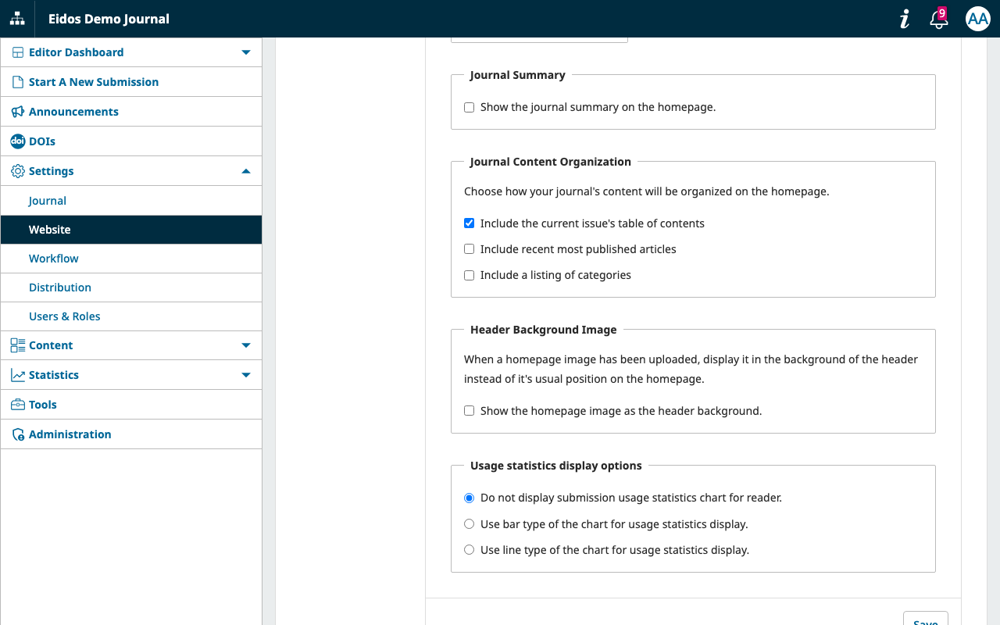

**Eidos.** No such option. Every article has a Metrics tab with a line
chart of views and downloads, so every journal on Eidos publishes its
download figures.

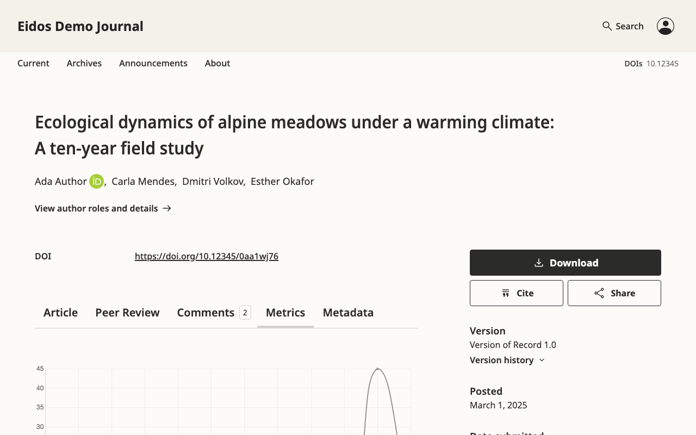

**Where.** Default `DefaultThemePlugin.php:118-135`. Eidos
`components/article/tabs.blade:32-38` shows the tab unconditionally.
`ThemePlugin::getUsageStatsChartData()` falls back to "line" when the
option is missing (`lib/pkp/classes/plugins/ThemePlugin.php:963-967`).

## Finding 4: funders are not shown

- **Compared with** the Default theme · Driven

**Default theme.** A "Funders" block lists each funder with its ROR
link, and under it each grant's name, number and DOI.

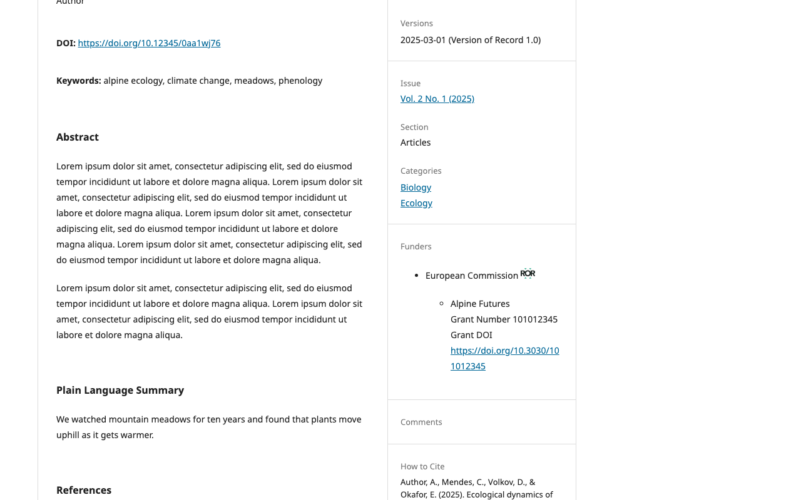

**Eidos.** No funder block exists. The same article's Metadata tab lists
everything else and no funders.

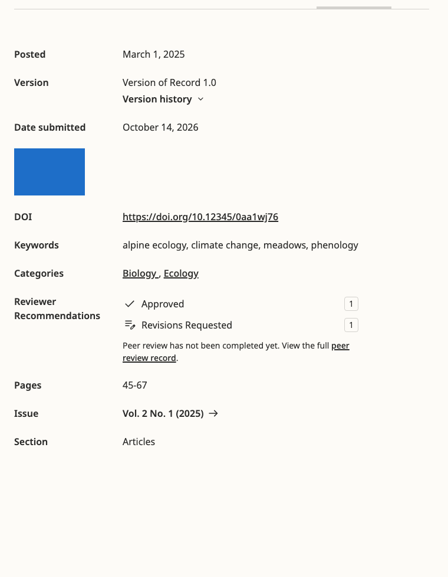

**Where.** Default `templates/frontend/objects/article_details.tpl:479-500`
(3.6 `submission.funders`). Neither Eidos nor the core metadata blocks
mention funders.

## Finding 5: contributor roles are not shown

- **Compared with** the Default theme · Driven

**Default theme.** Each author's contributor role ("Author") is printed
under the name and affiliation.

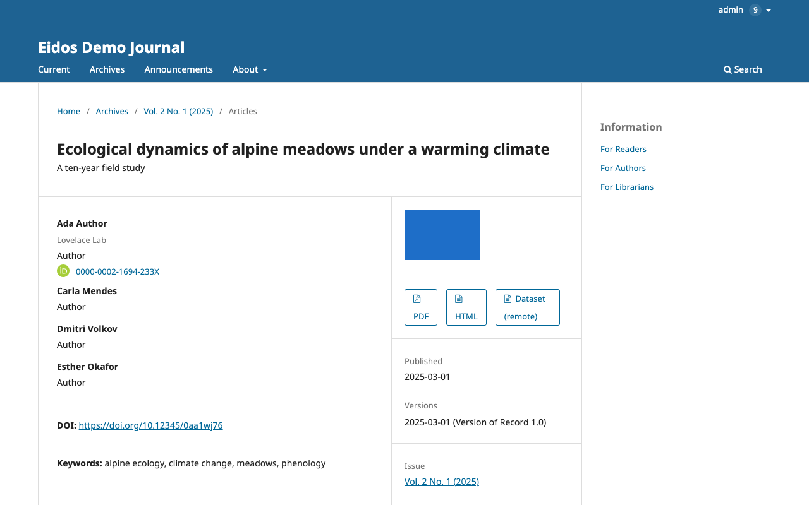

**Eidos.** "Author Details" lists names, affiliation and ORCID iD, but
no roles. The roles are counted to decide whether the section shows at
all.

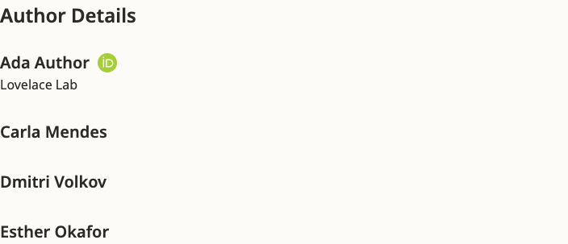

**Where.** Default `article_details.tpl:129`. Eidos
`components/article/tab-article.blade:69` counts
`getLocalizedContributorRoleNames()`, and `components/author-detail.blade`
never prints it.

## Finding 6: the issue page has no issue DOI

- **Compared with** the Default theme · Driven

**Default theme.** The issue page shows "DOI: https://doi.org/…" above
the published date.

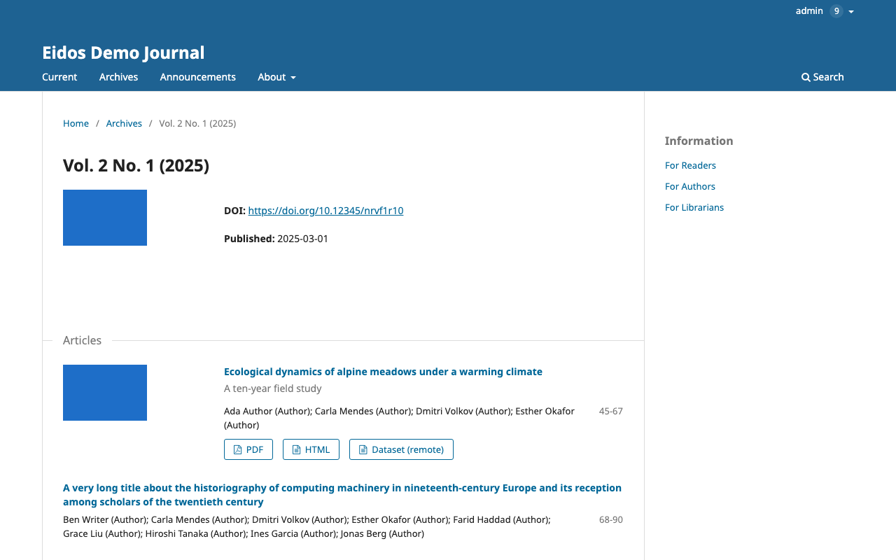

**Eidos.** No DOI on the same issue. The page numbers next to each
article are also missing (finding 7).

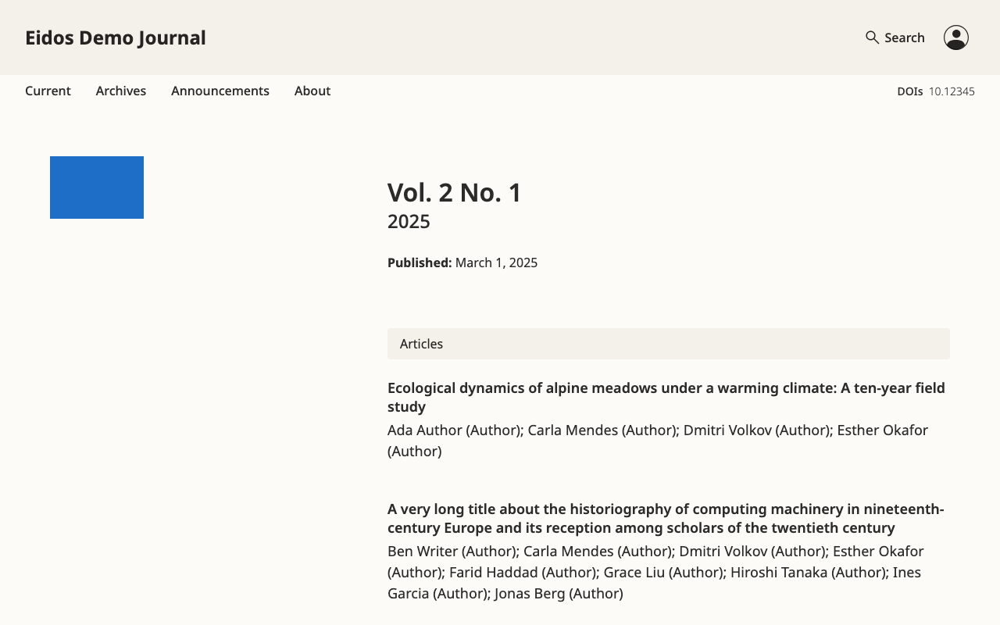

**Where.** Default `issue_toc.tpl:82-90` reads the issue's DOI object.
Eidos `components/issue-toc.blade:109-126` loops `$pubIdPlugins`, which
since 3.4 no longer carries DOIs and is not assigned (an "Undefined
variable" warning on every issue page).

## Finding 7: listings drop page numbers and ignore "hide author"

- **Compared with** the Default theme · Driven

**Default theme.** In the issue's table of contents each article shows
its pages (12-14). The "Reviews" section is set to hide authors in
listings, so its review shows no author.

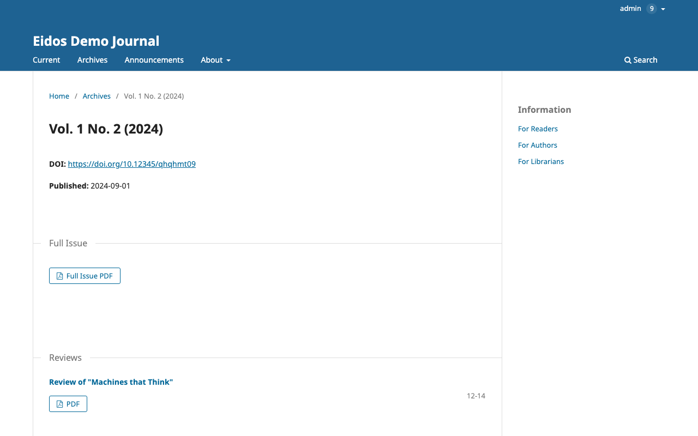

**Eidos.** No pages, and the review lists "Ada Author (Author)" despite
the section's setting.

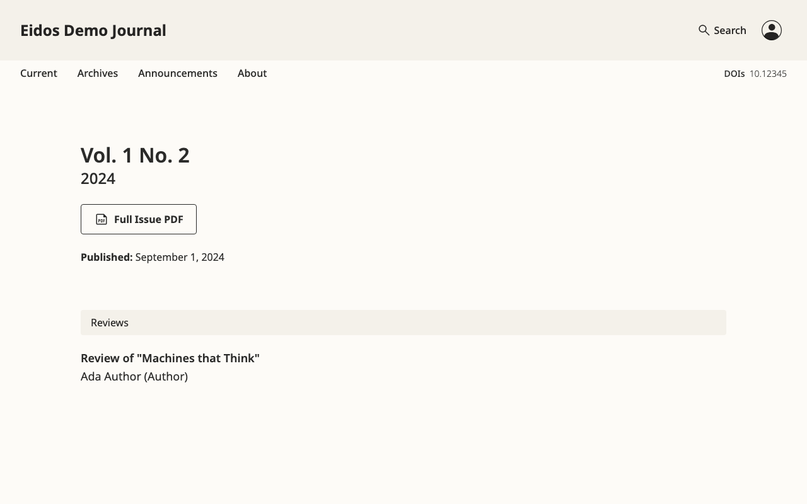

**Where.** Default `article_summary.tpl:27,61-73`. Eidos
`components/article-summary.blade:128-130` always prints authors and has
no pages.

## Finding 8: no "View All Issues" link under the home page's current issue

- **Compared with** the Default theme · Driven

**Default theme.** The current issue on the home page ends with "View
All Issues".

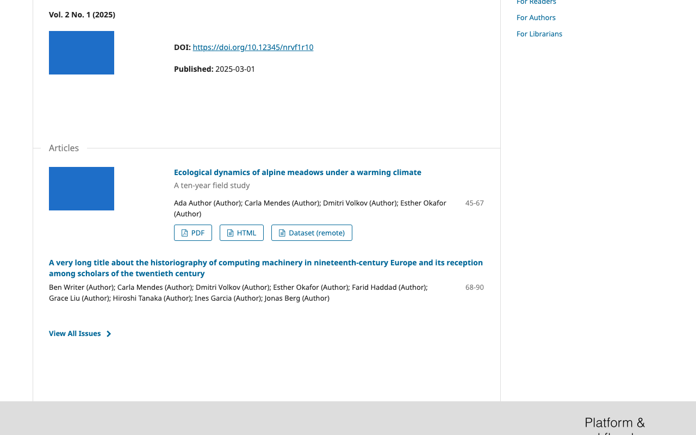

**Eidos.** The current issue block ends after the last article.

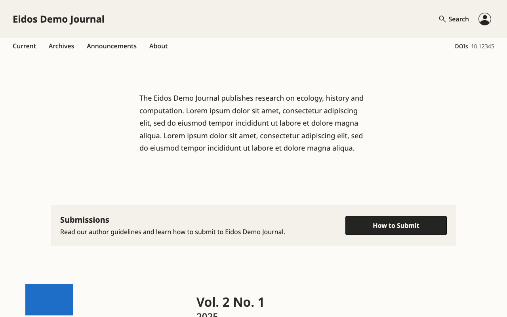

**Where.** Default `templates/frontend/pages/indexJournal.tpl`. Eidos
`templates/components/homepage-blocks/issue-toc.blade` (OJS).

## Finding 9: an announcement's page has no date

- **Compared with** the Default theme · Driven

**Default theme.** The announcement's date (2026-10-14) sits under its
title.

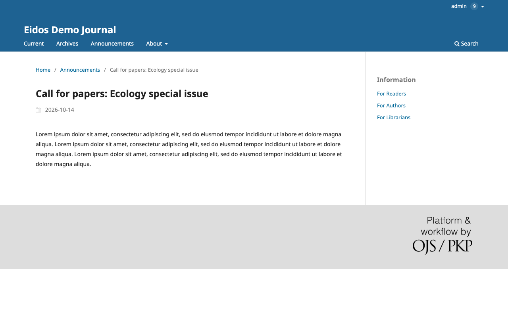

**Eidos.** Title and text only.

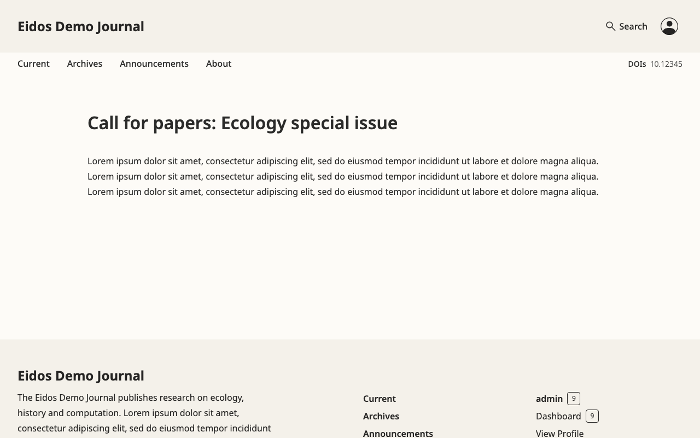

**Where.** Default `lib/pkp/templates/frontend/objects/announcement_full.tpl:18-19`.
Eidos `frontend/pages/announcement.blade`.

## Finding 10: no "Edit" links for managers

- **Compared with** the Default theme · Driven

**Default theme.** A signed-in manager sees "Edit" on About the Journal
(also on Contact, Submissions, Editorial History and the Information
pages), linking to the setting behind the page.

**Eidos.** The same manager sees no link.

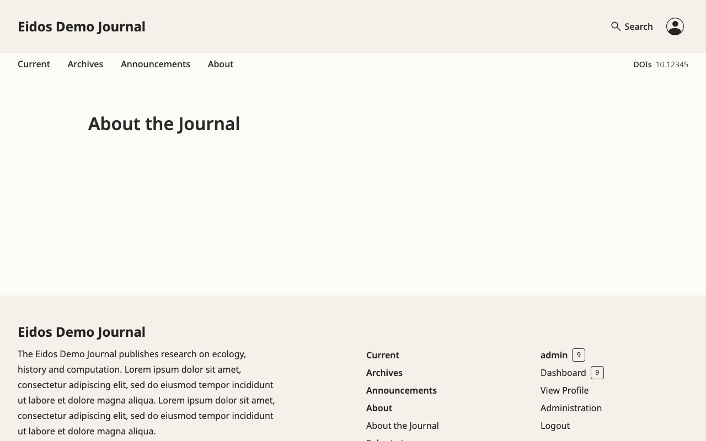

**Where.** The core `about.tpl`, `contact.tpl`, `submissions.tpl`,
`editorialHistory.tpl` and `information.tpl` print it. No Eidos template
does (grep `goToEditPage` / `common.edit`).

## Finding 11: no ORCID button at registration

- **Compared with** the Default theme · Driven

**Default theme.** With ORCID enabled for the journal, the register page
starts with "Create or Connect your ORCID iD" and "What is ORCID?".

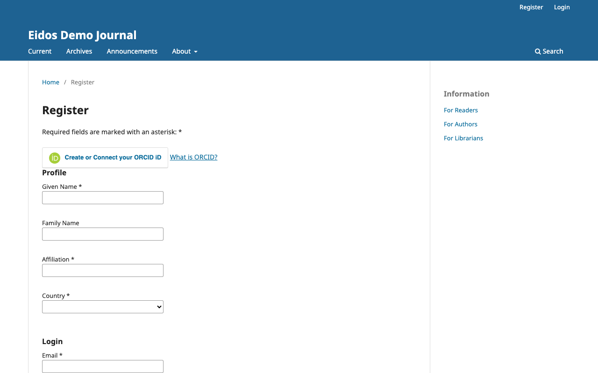

**Eidos.** The same journal's register page has no ORCID button.

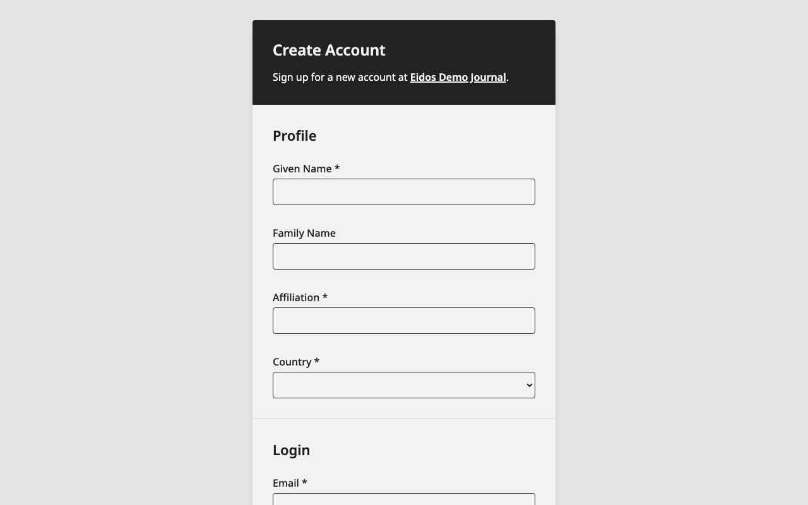

**Where.** Core `userRegister.tpl:30-31` includes `form/orcidProfile.tpl`
when `$orcidEnabled`. Eidos `frontend/pages/userRegister.blade` has no
equivalent.

## Finding 12: site-wide search has no journal filter, and results lose their journal and date

- **Compared with** the Default theme · Driven

**Default theme.** Searching from the site (all journals) offers a "By
Journal" filter. Each result names its journal and shows its published
date and pages.

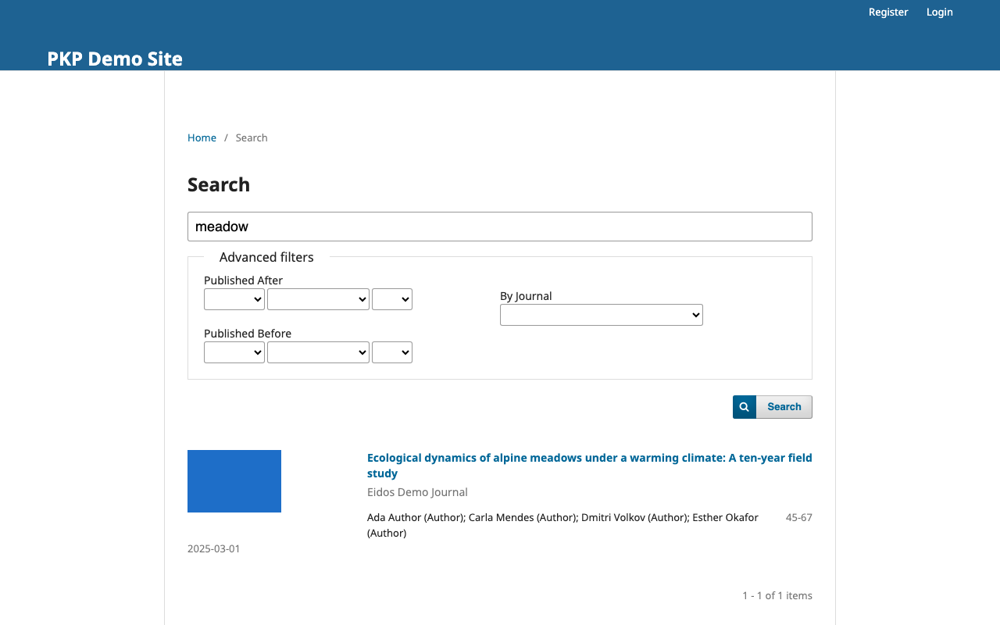

**Eidos.** Date filters only. The result shows title and authors, with
no journal name, date or pages.

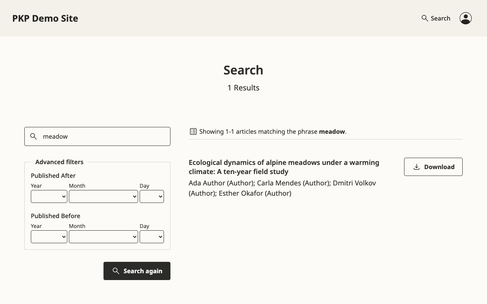

**Where.** Default `templates/frontend/pages/search.tpl:68-80`
(`searchableContexts`) and `article_summary.tpl:55`. Eidos
`components/search-form.blade:25-40`.

## Finding 13: the site's journal list has no thumbnails or "Current Issue" links

- **Compared with** the Default theme · Driven

**Default theme.** Each journal on the site home page shows its
thumbnail, its description, "View Journal" and "Current Issue".

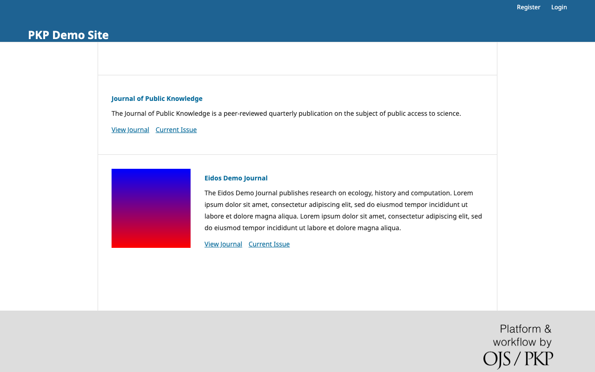

**Eidos.** With the "All Journals" block switched on (it is off by
default, the bug report's finding 6), each journal shows its name, description and
"View". There is no thumbnail and no link to the current issue.

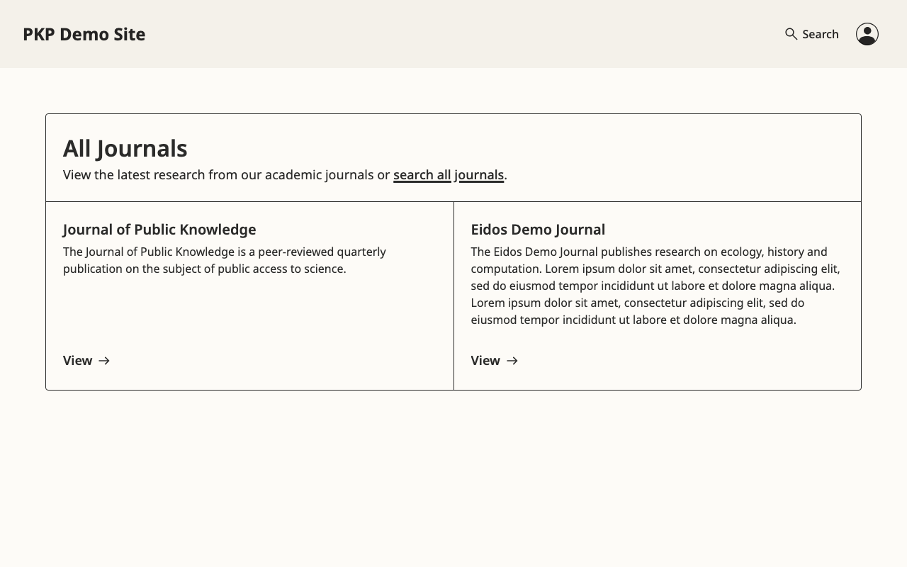

**Where.** Default `templates/frontend/pages/indexSite.tpl`. Eidos
`templates/components/homepage-blocks/contexts.blade`.

## Finding 14: sidebar blocks move to the footer

- **Compared with** the Default theme · Driven

**Default theme.** The blocks a manager places in Appearance › Sidebar
(here the Information block) sit in a column beside the content on every
page.

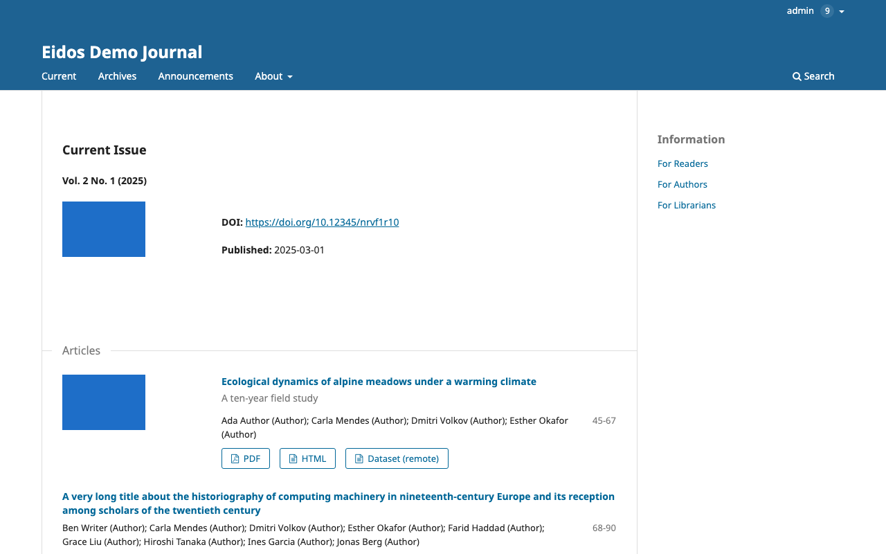

**Eidos.** The same blocks render at the bottom of every page, in the
footer under the menus. Nothing is lost, but blocks meant to be seen
(a submission call, a language switcher) end up at the very bottom.

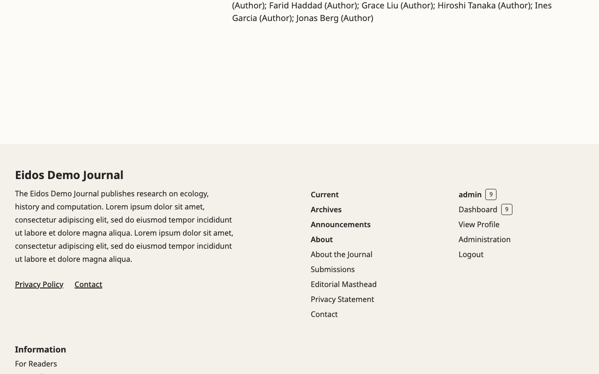

**Where.** Default `footer.tpl:22-26`. Eidos
`components/footer/index.blade:71-80` fires `Templates::Common::Sidebar`.

## Finding 15: the footer no longer links to About this Publishing System

- **Compared with** the Default theme · Driven

**Default theme.** The footer's "Platform & workflow by OJS / PKP" logo
links to the journal's About this Publishing System page.

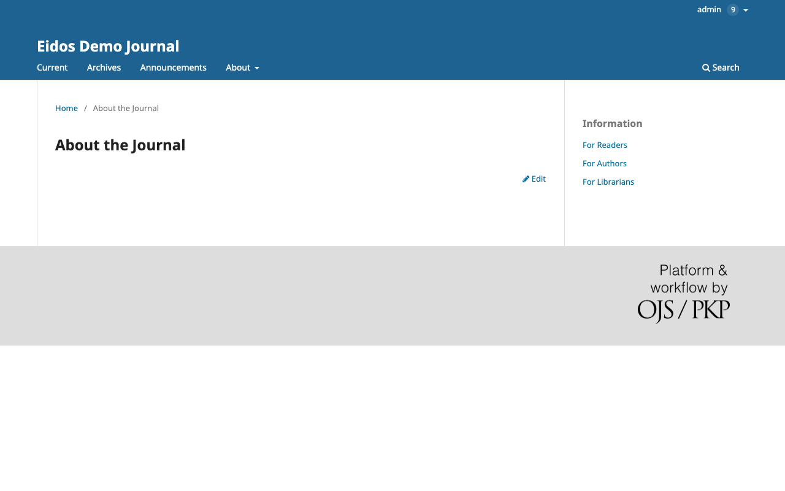

**Eidos.** The footer's "Hosted using Open Journal Systems by Public
Knowledge Project" links to pkp.sfu.ca. No Eidos page links to About
this Publishing System, which itself renders unstyled (finding 1).

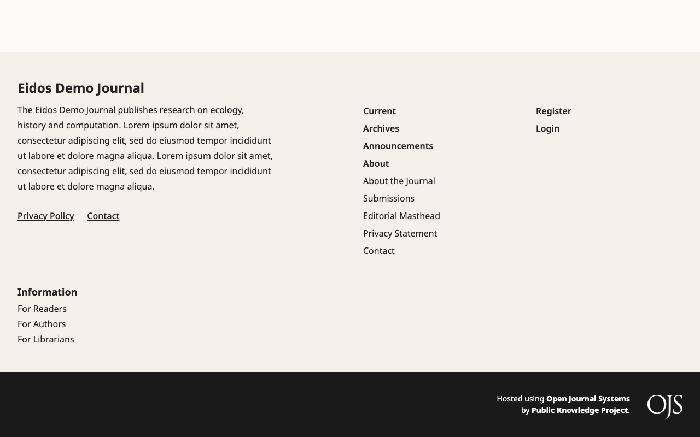

**Where.** Default `footer.tpl:43`. Eidos `components/footer/btm.blade:2,15`.

## Finding 16: right-to-left languages and print

- **Compared with** the Default theme · Driven (RTL), Code (print)

**Default theme.** In Arabic the whole page mirrors through the theme's
`rtl.less`.

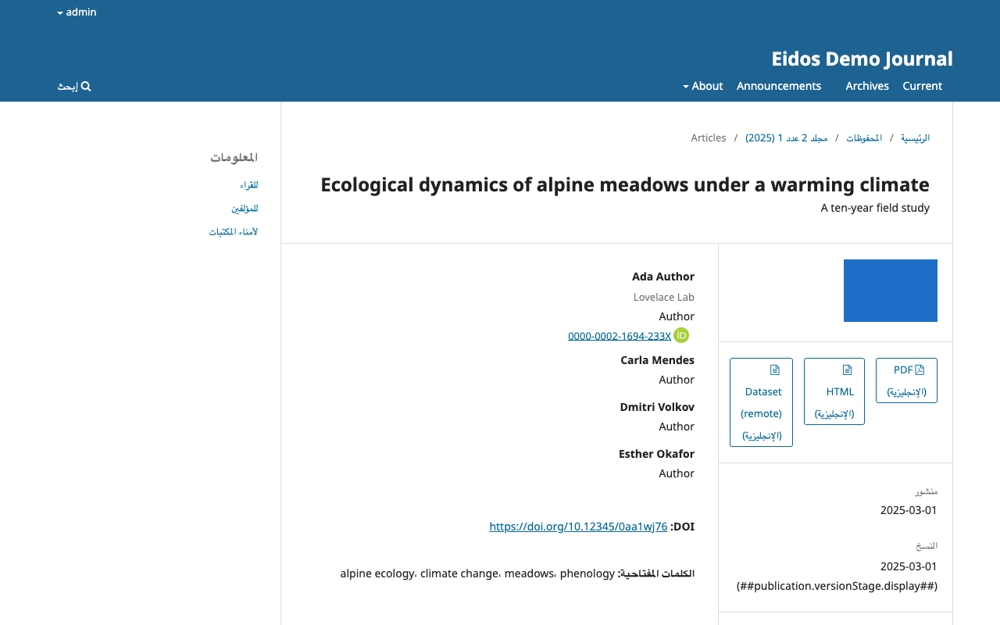

**Eidos.** The page mirrors as well: header, tabs, sidebar and text run
right to left. The raw `##…##` keys are Eidos texts with no Arabic
translation yet, which is not a finding. At a glance nothing is missing.
The code has scattered `[dir=rtl]` rules and about 65 physical
left/right properties, so other pages may still have spots. Neither
theme has print styles.

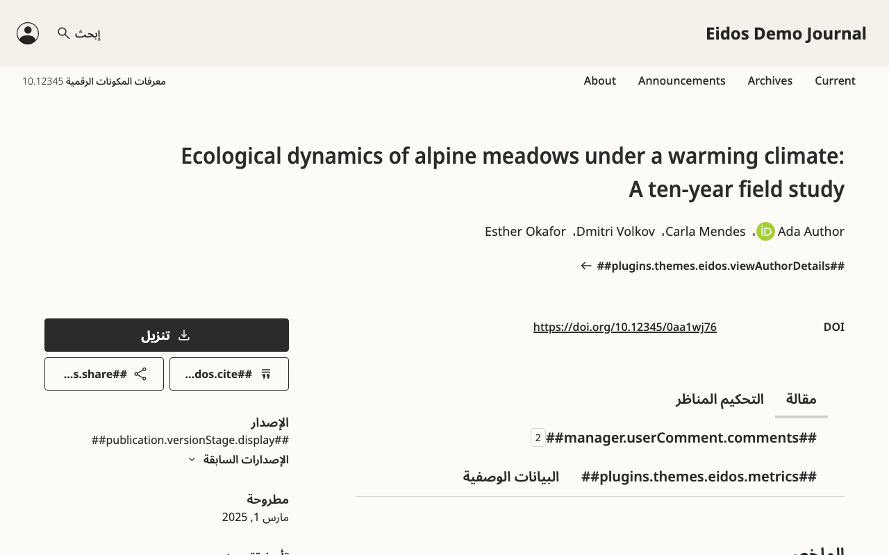

## Finding 17: review recommendations use the journal's wording, not the normalized label

- **Compared with** the ORE theme · Driven · the maintainer's choice

**ORE theme.** Each review in the Peer Review Record is headed by the
normalized recommendation: "Approved", "Revisions Requested".

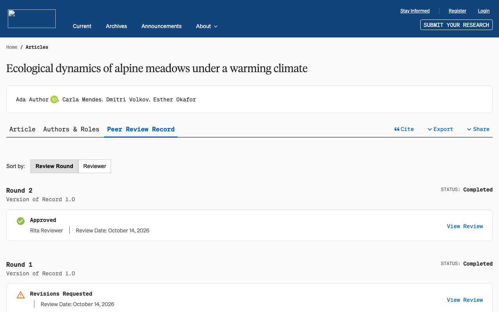

**Eidos.** The same reviews are headed by the journal's own wording,
"Accept Submission" and "Resubmit for Review". The sidebar summary
beside them uses the normalized labels, so the two disagree on one
screen.

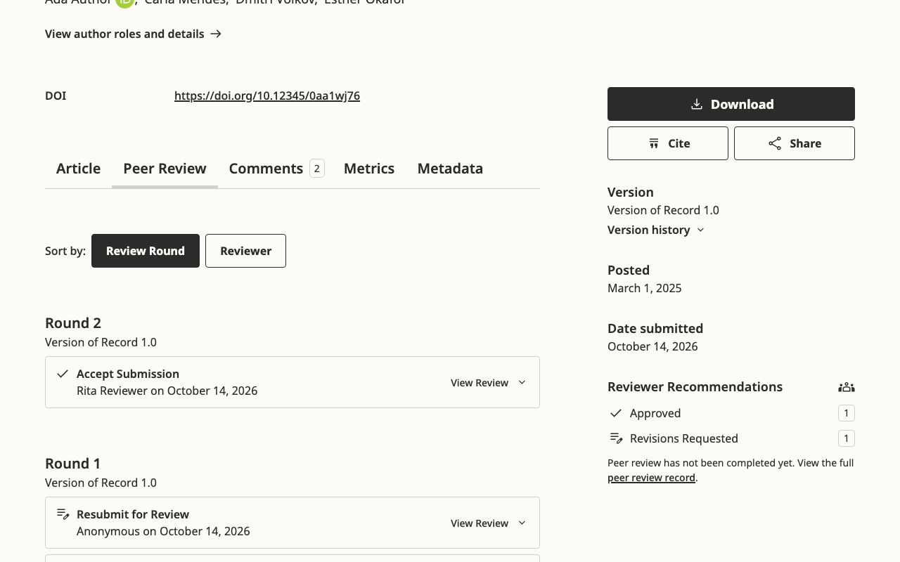

**Where.** Eidos `components/article/tab-peer-review.blade:78,191` print
`reviewerRecommendationDisplayText`. ORE and the ui-library open-review
components use the type label (`reviewerRecommendationTypeLabel`).

## Finding 18: a registered review DOI does not open its review

- **Compared with** the ORE theme · Driven

**ORE theme.** Crossref registers each review's DOI with the address
`…/article/view/<id>?tab=peer-review-record&reviewId=<n>`. Opening it
switches to the Peer Review Record, expands that review and scrolls to
it.

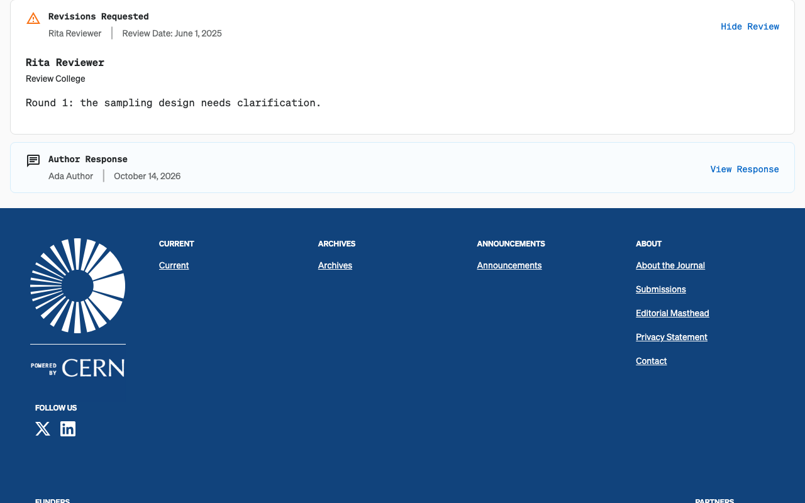

**Eidos.** The same address opens the Article tab with nothing expanded.
Eidos's tabs use `?section=peer-review` and ignore `reviewId`.

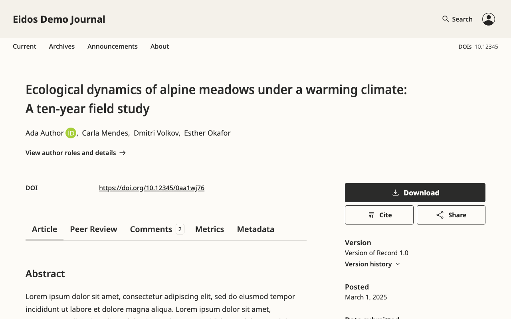

**Where.** crossref-ojs `filter/PeerReviewCrossrefXmlFilter.php:118-131`
writes the address. ui-library `usePkpOpenReviewStore.js`
(`scrollToReviewFromUrl`) handles it for ORE. Eidos
`components/article/tabs.blade:15,49`.

## Finding 19: anonymous reviews in the by-reviewer view

- **Compared with** the ORE theme · Driven

**Eidos.** Sorted by reviewer, every anonymous review falls into one
group whose heading is empty (an empty `<h3>`). Two anonymous reviews in
one round would also share an accordion value.

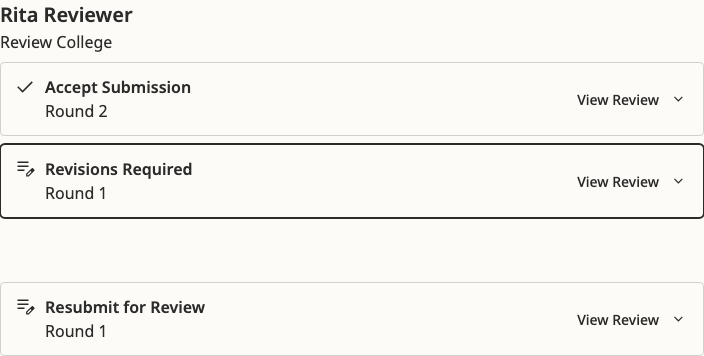

**ORE theme.** No working reference: the same view goes blank, with
`TypeError: Cannot read properties of null (reading 'localeCompare')`
in the console. The ui-library sort assumes every review has a
reviewer name. Both need the anonymous case handled. ORE also sorts
reviews newest first within a round and sorts reviewer groups by name,
which Eidos does not.

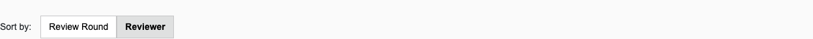

**Where.** Eidos `components/article/tab-peer-review.blade:8-27,169-188`.
ui-library `usePkpOpenReviewStore.js` (`reviewerGroups`).

## Finding 20: no Crossref "Cited by"

- **Compared with** the ORE theme · Code

**ORE theme.** The Metrics tab shows the Crossref citation count, "via
Crossref", and a "View citing articles" window
(`components/crossrefCitedBy.blade:12-45`, used in
`objects/article_details.blade:353-358`).

**Eidos.** Nothing. The Crossref plugin adds its Cited by block through
`Templates::Article::Details`, which Eidos does not fire (finding 2).
crossref-ojs#107 adds a metadata block for Crossmark only.

Not screenshotted: Cited by needs live Crossref data, which a test
install cannot reach.

## Evidence

- **Heads.**
  - pkp-lib#13260 `571ea1fcac` (base `151e6e9d69`)
  - ojs#5784 `b8904676e1` (base `49515c6e3e`, with the pointer bumps)
  - ui-library#972 `96764aa950`
  - crossref-ojs#107 `9e869168b9`
  - The plugin submodules are at the PR's pointers.
  - ORE theme: `16b821e` (`ore/ore` `d7cf416029`).
- **Install.**
  - OJS was checked out at ojs#5784 with its submodules and built.
  - Eidos was built in `plugins/themes/eidos` with `npm install && npm run
    build`; `npm ci` fails (the bug report's finding 35).
  - The first report's fix diffs for the shared code were applied, so its
    findings would not get in the way. One exception: for the bug report's finding 2,
    `ReviewRoundAuthorResponseResource.php` was put back to the PR head.
  - PKP's default dataset for `main` (pkp/datasets `1a5552c`), PostgreSQL,
    PHP's built-in server.
- **Content.** A second journal, "Eidos Demo Journal", was seeded through
  the harness's scenario API with Eidos as its theme:
  - three published issues and one future issue, with covers and a
    full-issue PDF
  - three categories, one with a subcategory
  - three announcements, one homepage highlight, a static page, a logo
    and a principal contact affiliation
  - open review with public visibility, public comments on
  - an article with:
    - three co-authors, keywords, subjects, a plain language summary,
      references and a data citation
    - PDF, HTML and remote galleys
    - three review rounds, completed reviews confirmed by the editor, an
      author response
    - approved, pending and reported comments, and usage figures
    - a second published version made through the publications API
  - an article with eight authors and no galley, a review article, an
    article with no review, and one still in review
  - a masthead editor, a section editor, a board member whose role ended
    in 2025, and a reviewer with an ORCID iD whose review is dated last
    year
- **Comparisons** (findings 3 to 20) were taken on a re-seeded copy
  of the same journal, with these additions:
  - DOIs for articles and issues
  - ORCID enabled with test credentials
  - Arabic as a second language
  - a funder with a grant, page numbers, and a section set to hide authors
  - a journal thumbnail and the Information block in the sidebar
  - one review set to double-anonymous, and one backdated

  Each page was shot with the journal's theme switched between Default,
  Eidos and ORE. For the ORE shots, `ore/plugins/themes/oreTheme`
  (`16b821e`) was copied into the checkout for the session; its article
  and Peer Review Record pages render on the PR heads, and its home page
  does not.
- **Code.** The comparison with the Default theme and ORE was read at the
  heads above.
- **Not kept.** The walk scripts were throwaway, and no checks were added
  to the suite.
