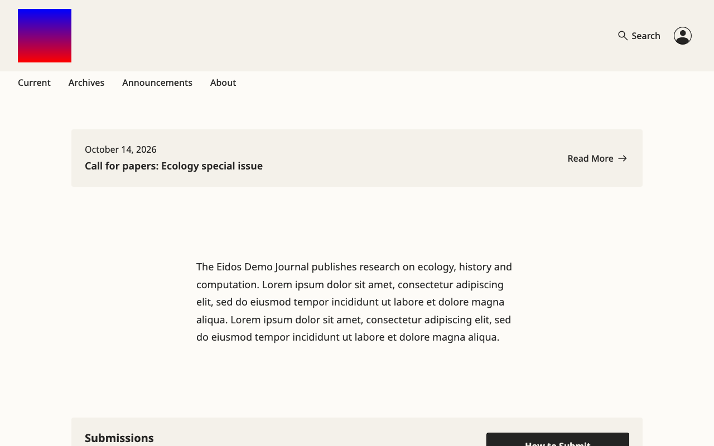
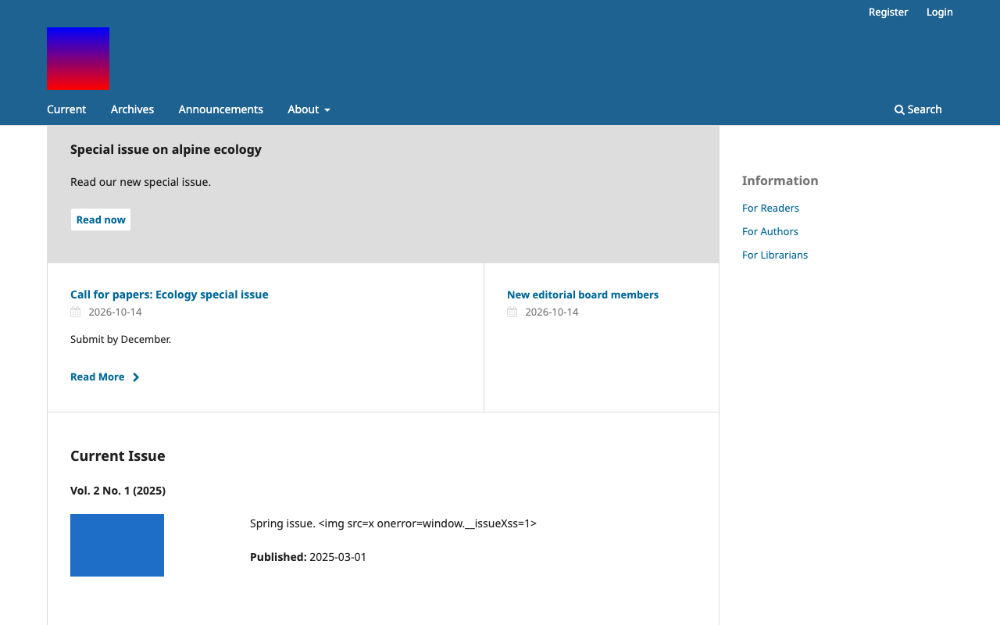
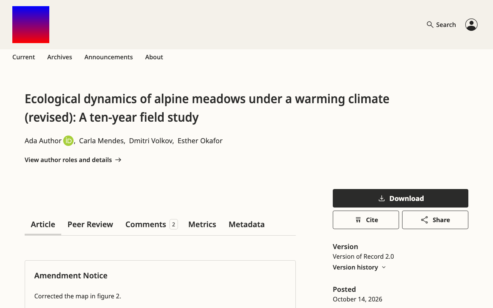
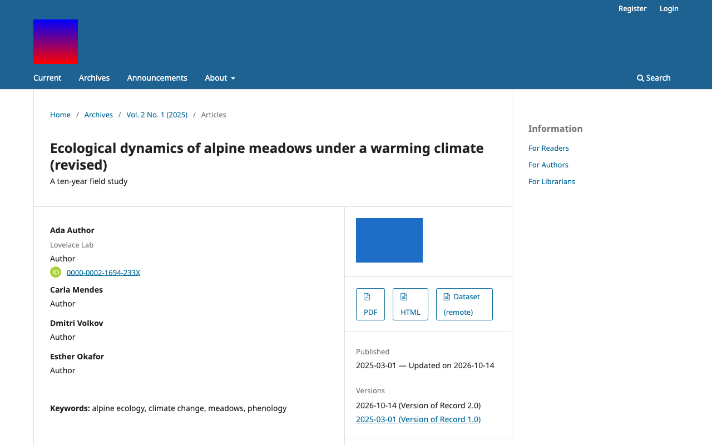
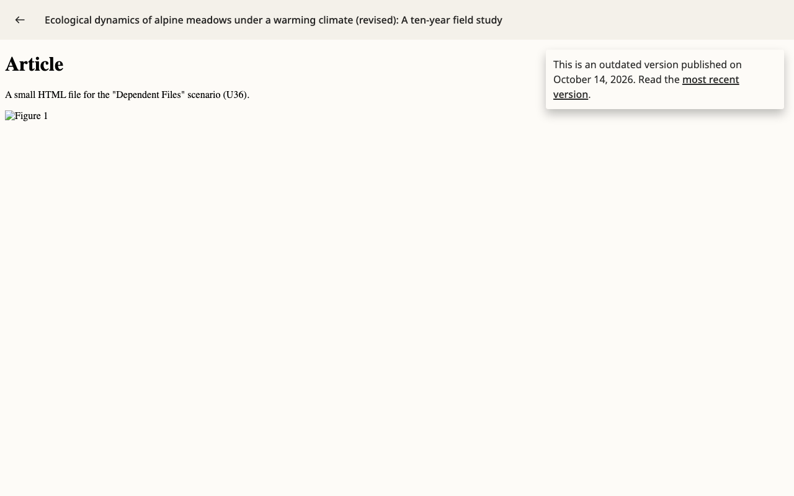
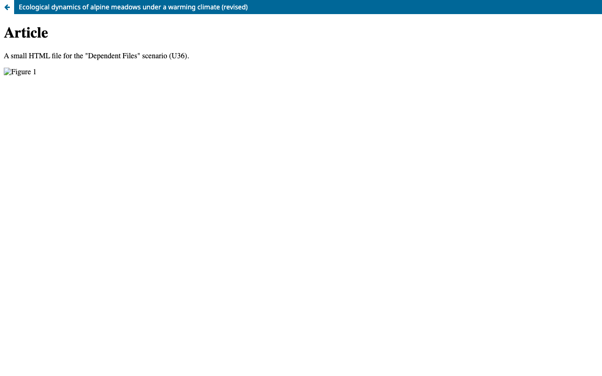
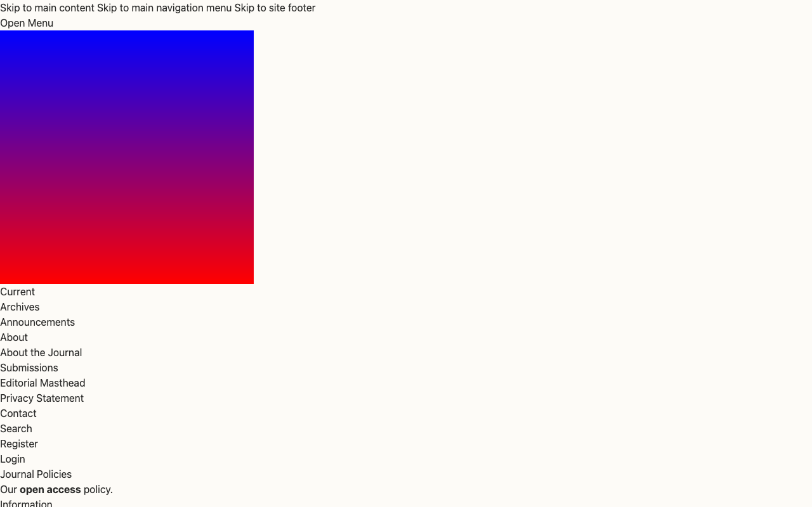
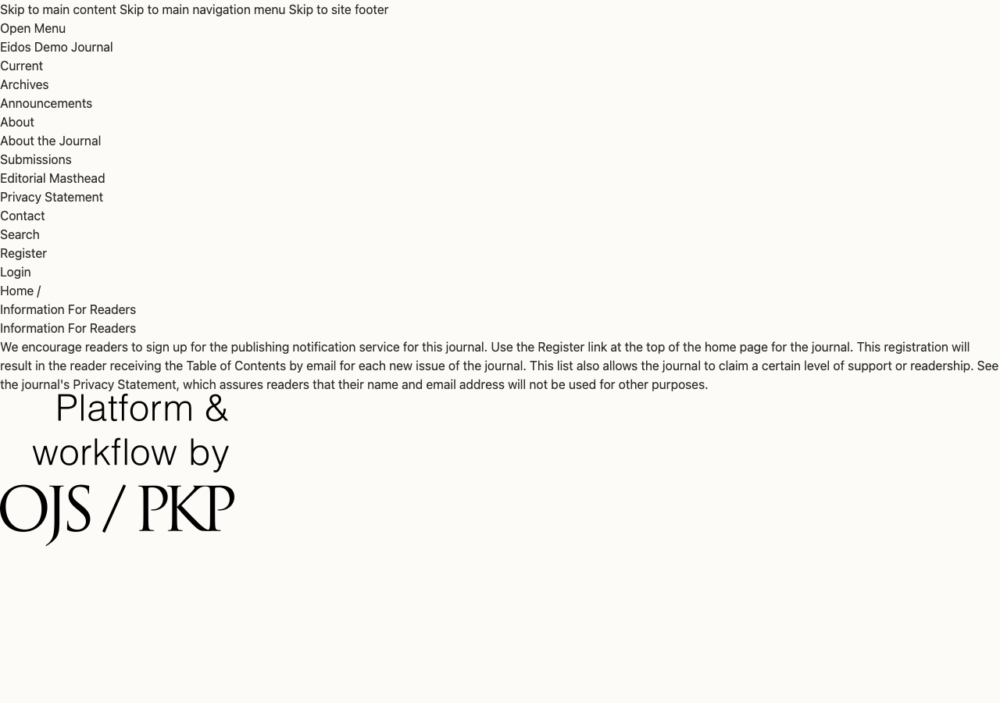
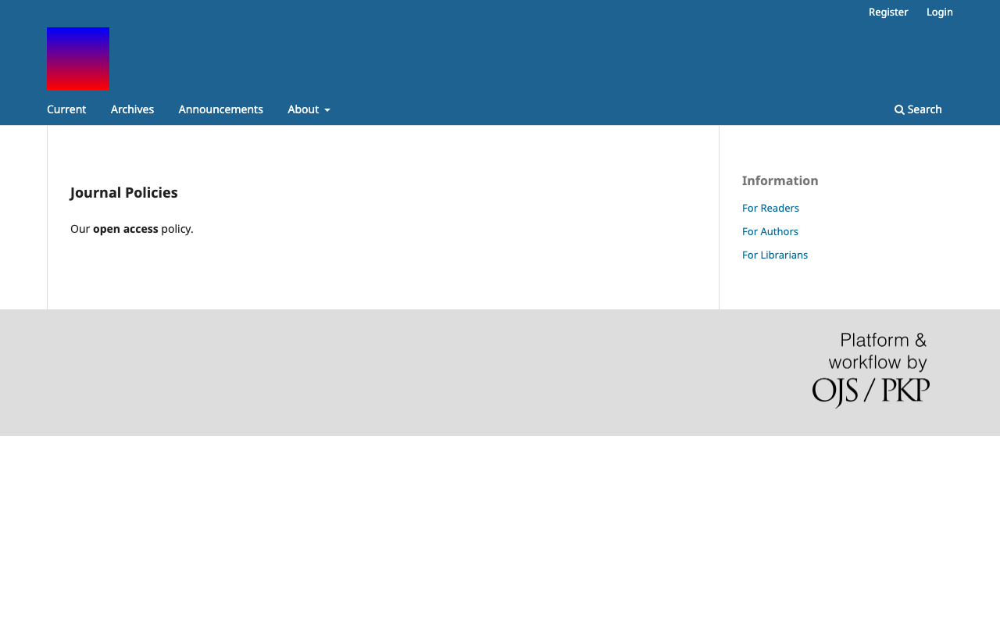

# The Eidos theme itself: bugs, and what it lacks against the Default and ORE themes

- **Scope** the Eidos theme with Eidos enabled. The first report,
  `2026-10-08-pkp-lib-13260.md`, covered what the same PRs break on
  installs that never switch to Eidos.
- **PRs** `pkp-lib#13260`, `ojs#5784`, `ui-library#972` and `crossref-ojs#107`,
  for `pkp-lib#13242`. Their heads are listed in Evidence and have not
  changed since the first report.
- **Checked** 2026-10-14, OJS only (Eidos is an OJS theme). Eidos was built
  from its own `package.json` and driven live in Chromium at 1280 px and
  390 px, on the Default theme as well for comparison. The code was read
  at the PR heads.
- **References** the Default theme (OJS `main`) and the ORE theme
  (`ore/plugins/themes/oreTheme`, `16b821e`). For the ORE-only grey areas
  the maintainer decided: the corresponding-author block and the
  normalized recommendation label are in scope. Awaiting-review states,
  review status, reviewer names and funders in listings, the reviewer
  search filter, first-and-latest version dates, inline HTML full text,
  category images, breadcrumbs, a header Submit button, a comments
  shortcut, sharing the DOI link, a PDF-plus-JATS download count and
  pages for gallery plugins are not required.
- **Model** claude-opus-5-5

Each item is marked **Driven** (seen on the live install) or **Code**
(read in the code only).

## Summary

Eidos is a complete, polished design for the pages it covers: the home
page blocks, the issue pages, the article page with its tabs, search,
categories, announcements, the About pages, login and registration. The
problems fall into four groups:

1. **Two script injections.** A search link runs script for whoever opens
   it, and an author's response to reviewers runs script on the public
   article page.
2. **Pages and flows that break.**
   - Images and stylesheets inside HTML galleys answer 404.
   - Registration fails silently when a captcha or the site-wide privacy
     statement is on.
   - The masthead answers 500 when it lists a reviewer with an ORCID iD.
   - The site home page answers 500 on a fresh install, and is empty once
     it renders.
   - A full-issue PDF downloads instead of opening in the viewer.
   - Every page Eidos has no template for renders unstyled: static
     pages, the Information pages, the subscription pages and others.
3. **Wrong information on public pages.**
   - Every masthead person gets a fake, verified ORCID iD.
   - Editorial History has no dates.
   - The "outdated version" notice in the galley viewers is the wrong
     way round.
   - The metrics block shows only when a count is zero.
   - Peer review appears on articles that were never reviewed.
   - Every OJS article's date reads "Posted".
4. **Missing pieces.**
   - Only four plugin hooks are fired, so Crossref "Cited by", the two
     recommendation plugins and OpenID sign-in disappear.
   - Usage statistics cannot be hidden.
   - Funders and contributor roles are never shown.
   - A registered review DOI does not open its review.
   - There are a dozen smaller gaps against the Default theme.

| # | Finding | Severity | Effort | Seen |
|---|---|---|---|---|
| [1](#finding-1) | Search page prints the query as HTML: a link runs script (security) | high | small | Driven |
| [2](#finding-2) | Author's response to reviewers printed as HTML on the public article page (security) | high | small | Driven |
| [3](#finding-3) | HTML galleys lose their images and stylesheets (404) | high | small | Driven |
| [4](#finding-4) | Registration fails silently with a captcha on, or at site level with the site-wide privacy statement on | high | small | Driven |
| [5](#finding-5) | Editorial Masthead answers 500 when it lists a reviewer with an ORCID iD | high | small | Driven |
| [6](#finding-6) | Every masthead and history person shows a fake, verified ORCID iD | high | small | Driven |
| [7](#finding-7) | Pages without an Eidos template render unstyled (static pages, Information, subscriptions, …) | medium | medium | Driven |
| [8](#finding-8) | Only four plugin hooks are fired: Cited by, recommendations, OpenID, footer plugins disappear | high | medium | Code |
| [9](#finding-9) | Site home page: 500 without a site title, empty with one | medium | small | Driven |
| [10](#finding-10) | "Outdated version" notice inverted in the PDF and HTML viewers | medium | small | Driven |
| [11](#finding-11) | Full-issue PDF crashes the viewer template and downloads instead | medium | small | Driven |
| [12](#finding-12) | Peer review shown per journal, not per article; metrics block inverted | medium | small | Driven |
| [13](#finding-13) | Editorial History shows no dates; contact page prints template source | medium | small | Driven |
| [14](#finding-14) | Smaller bugs (dates, labels, raw keys, escaping, accessibility, warnings, build) | low | small | Driven / Code |
| [15](#finding-15) | Missing against the Default theme | — | — | Driven / Code |
| [16](#finding-16) | Missing against the ORE theme (general features, and the two the maintainer chose) | — | — | Code |
| [17](#finding-17) | Side effect on the Default theme: the comments sign-in link lost its anchor | low | small | Driven |

Findings 1 and 2 carry the `security` label. Eidos is unreleased, so per
the security policy they are ordinary findings. Two manager-only
injections are in finding 14.

## How it looks

The same journal, the same content, Eidos first and the Default theme
second:






<a name="finding-1"></a>
## Finding 1: the search page prints the query as HTML

- **Severity** high · **Effort** small · **Security** unreleased · Driven

**What happens.** A search address carrying markup in `query` puts that
markup into the results line, and a script in it runs. Anyone can
receive such a link, an editor or a manager included.

**Steps.** Open
`/index.php/<journal>/search/search?query=zz`.
`window.__q` is `1`, and an injected `` sits in "Showing 1-1 articles
matching the phrase …". The Default theme prints the query as text.


**Cause.** `plugins/themes/eidos/templates/frontend/pages/search.blade:61`
and `:76` print `__('plugins.themes.eidos.search.noMatches' | …showing…,
['phrase' => $query])` with `{!! !!}`. `$query` is the raw request value.
`:23` also builds `$urlPattern` from raw `$_SERVER['REQUEST_URI']`, and
`components/pagination-custom.blade:75` prints it unescaped in an `href`.

**Fix.** Escape the phrase before it goes into the translation, as in
`['phrase' => e($query)]`, and keep `{!! !!}` only for the markup the locale
adds. Print `$urlPattern` with `{{ }}`, and build it from the route rather
than `REQUEST_URI`.

<a name="finding-2"></a>
## Finding 2: an author's response to reviewers runs on the public article page

- **Severity** high · **Effort** small · **Security** unreleased · Driven

**What happens.** With open review, the Peer Review tab shows the
author's response under each round. The response is printed as HTML
without cleaning, so markup the author typed runs for every reader.

**Steps.** On a published article with public, confirmed reviews, store
an author response holding ``.
Open the article's Peer Review tab and press "Author Response".
`window.__authorXss` is `1`.

**Cause.** `components/article/tab-peer-review.blade:154` prints
`{!! $round['authorResponse']['response'] !!}`. Every other review field
in Eidos goes through `ViewHelper::sanitizeHtml()`, and ORE's Vue
component cleans the response too (`v-strip-unsafe-html`).

**Also wrong here.** The response's header gives the date of the round's
last review, not of the response (`:110` uses the leftover
`$review['dateCompleted']`). In the screenshot it reads "June 1, 2025"
above a response dated October 14, 2026.


**Fix.** Use `{!! ViewHelper::sanitizeHtml(...) !!}`, and take the date from
`$round['authorResponse']['createdAt']`.

**Note on the first report.** Finding 7 there proposes that
`ReviewRoundAuthorResponseResource` return the response as a locale map,
which the editor's window needs. With that fix in place this template
prints "Array". So the Eidos fix must pick the localized value as well
as sanitize it.

<a name="finding-3"></a>
## Finding 3: HTML galleys lose their images and stylesheets

- **Severity** high · **Effort** small · Driven

**What happens.** An HTML galley opens in Eidos's viewer, but every file
the HTML refers to (stylesheet, figures) answers 404. Readers see broken
images and unstyled text. On the Default theme the same galley loads
them.

**Steps.** Publish an HTML galley with a dependent image and stylesheet,
then open it from the article page.
- Eidos requests `…/article/download/21/figure.png` and gets 404.
- Default requests `…/article/download/21/11/figure.png` and gets 200.




**Cause.**
`plugins/themes/eidos/templates/plugins/generic/htmlArticleGalley/templates/display.blade:5-16`
builds the iframe address as `article/download/<id>/<galleyId>?inline=1`,
without the file id. The plugin's own `display.tpl:41,45` passes
`<galleyId>/<fileId>`. Relative links inside the HTML therefore resolve
one level too high, where nothing serves them.

**Fix.** Append `$submissionFile->getId()` to the path, as the plugin's
template does.

<a name="finding-4"></a>
## Finding 4: registration fails silently under two common settings

- **Severity** high · **Effort** small · Driven

**What happens.**
- **With a captcha on registration** (`[captcha] altcha = On` with the
  default `altcha_on_register = on`, or reCAPTCHA with
  `captcha_on_register`): Eidos's registration form shows no captcha
  widget. The server refuses the form every time, and the page comes
  back with the passwords cleared and no message, so nobody can register
  and nobody is told why. With ALTCHA off the same form registers. On
  the Default theme, with ALTCHA on, the widget shows and registration
  succeeds.
- **At site level with `sitewide_privacy_statement = On`** and a site
  privacy statement: the form has no site consent box. It is refused the
  same silent way. On the Default theme the box `privacyConsent[0]` shows
  and registration succeeds.


Field errors do show ("The selected username is already in use…"). What
is missing is the form-level error, so these two refusals are invisible.

**Cause.** `frontend/pages/userRegister.blade` has no reCAPTCHA or ALTCHA
block; `userLogin.blade:75-81` has both. The consent boxes sit under
`@if ($currentContext)` (`:277`), and nothing prints the form's general
errors.

**Fix.**
- Add the captcha blocks from `userLogin.blade`.
- Add the site consent box when `$enableSiteWidePrivacyStatement` is set,
  as core `userRegister.tpl:136-148` does.
- Print the form's error list at the top.

<a name="finding-5"></a>
## Finding 5: the Editorial Masthead answers 500 when it lists a reviewer with an ORCID iD

- **Severity** high · **Effort** small · **Crash** server · Driven

**What happens.** With the masthead's reviewer list on
("enableEnrollmentMastheadReviewers") and one of last year's reviewers
holding an ORCID iD, the whole page answers 500.

**Server log.**

```
Call to a member function getData() on string (View: …/editorialMasthead.blade)
```

**Cause.** `frontend/pages/editorialMasthead.blade:52` calls
`$reviewer->getData('orcid')->getData('orcid')`, but `getData('orcid')`
is a string.

**Fix.** Use `$reviewer->getData('orcid')` directly, and
`$reviewer->hasVerifiedOrcid()` for the badge.

<a name="finding-6"></a>
## Finding 6: every masthead and history person shows a fake, verified ORCID iD

- **Severity** high · **Effort** small · Driven

**What happens.** On Editorial Masthead and Editorial History every
person has a green ORCID iD icon linking to `https://orcid.org/123454646`,
whether or not they have an ORCID. The Default theme shows an iD only
for verified ones.


**Cause.**
- `components/masthead-user.blade:10` hard-codes
  `$orcid = 'https://orcid.org/123454646'`.
- `editorialMasthead.blade:18` and `editorialHistory.blade:22` pass
  `hasVerifiedOrcid="$mastheadUser[…]->hasVerifiedOrcid()"` without the
  `:` binding, so the attribute is a non-empty string and always true.

**Fix.** Pass the user's iD (`:orcid="$user->getData('orcid')"`), bind
`:hasVerifiedOrcid`, and show the icon only when both are set.

<a name="finding-7"></a>
## Finding 7: pages without an Eidos template render unstyled

- **Severity** medium · **Effort** medium · Driven

**What happens.** A page Eidos has no `.blade` for falls back to the core
Smarty page with the core header and footer markup, which Eidos's CSS
does not style. The result is a bare list of links followed by the
content: no header, no layout, and a large "Platform & workflow by OJS /
PKP" image.

Pages affected (Driven for the first three):
- static pages (Static Pages plugin)
- the Information pages for readers, authors and librarians (also linked
  from the Information block)
- About this Publishing System
- the subscription pages: about/subscriptions, user subscriptions, and
  purchasing individual and institutional subscriptions
- the manual payment form
- ORCID verify and ORCID about
- notification unsubscribe
- the LOCKSS and CLOCKSS pages
- the masthead-disabled page





**Why medium.** The content can still be read, so it sits below high.
Static pages are in wide use, which is what would raise it.

**Fix.** Either Blade templates for these pages (ORE has `information`,
`aboutThisPublishingSystem`, `orcidVerify` and static pages), or Eidos
versions of `frontend/components/header.tpl` and `footer.tpl` that wrap a
core page in Eidos's header and footer.

<a name="finding-8"></a>
## Finding 8: only four plugin hooks are fired

- **Severity** high · **Effort** medium · Code

Eidos's templates call `Templates::Search::SearchResults::AdditionalFilters`,
`::PreResults`, `Templates::Common::Sidebar` and
`Templates::Article::Details::Reference`, and nothing else (grep for
`@callHook`).

| Hook not fired | What disappears |
|---|---|
| `Templates::Article::Details` | Crossref "Cited by" (`CrossrefCitedBy.php:54`), PFL |
| `Templates::Article::Main` | third-party article plugins |
| `Templates::Article::Footer::PageFooter` | Recommend by Author, Recommend Similar Articles (both bundled) |
| `Templates::Common::Footer::PageFooter` (pages and galley viewer) | footer injectors |
| `Templates::User::Login::BeforeForm` / `AfterForm` | OpenID sign-in buttons, SSO plugins |
| `Templates::User::Register::BeforeForm` / `AfterForm` | registration add-ons |
| `Templates::Index::journal`, `Templates::Issue::Issue::Article` | home page and issue listing plugins |

The PR's replacement is the metadata and homepage block interface, which
only Crossref implements so far (Crossmark as a block). So either Eidos
fires the legacy hooks in matching places, or each plugin is ported.
Cited by is a 3.6 feature that ORE shows in its Metrics tab.

<a name="finding-9"></a>
## Finding 9: the site home page answers 500 without a site title, and is empty with one

- **Severity** medium · **Effort** small · **Crash** server · Driven

**What happens.**
- With Eidos as the site's theme, the site home page answers 500 while
  the site has no title. That is the state a fresh install is in: neither
  PKP's test dataset nor the campaign's own install stores a site title.
  The admin can fix it by saving a Site Name.
- Once a title exists, the page renders a header, an empty body and the
  footer, with no list of journals, although two journals are enabled.


**Cause.**
- `EidosTheme.php:218-224` `contextName(): string` returns
  `getSite()->getLocalizedTitle()`, which is null. The resulting
  TypeError aborts `addTemplateData`, so `$getBlocks` is never shared and
  `homepage-blocks/index.blade` fails.
- The site uses `Options::HOMEPAGE_BLOCKS_DEFAULT` (announcement, about,
  how-to-submit, issue-toc), which holds nothing a site can show. The
  journals block `homepage-blocks.contexts` is never on by default.

**Fix.** Return `?? ''` in `contextName()`, and give the site its own
default block list starting with `homepage-blocks.contexts`.

<a name="finding-10"></a>
## Finding 10: the "outdated version" notice is the wrong way round in the galley viewers

- **Severity** medium · **Effort** small · Driven

**What happens.** With two published versions:
- The **latest** version's PDF and HTML galleys say "This is an outdated
  version published on October 14, 2026. Read the most recent version."
- The **old** version's galleys say nothing.

The article pages themselves are right, and so is the Default theme in
both places.


**Cause.** `!$isLatestPublication ? '' : notice` in
`templates/plugins/generic/pdfJsViewer/templates/display.blade:7-14` and
`htmlArticleGalley/templates/display.blade:24-31`.

**Fix.** Swap the two branches.

<a name="finding-11"></a>
## Finding 11: a full-issue PDF crashes the viewer template

- **Severity** medium · **Effort** small · Driven

**What happens.** On an issue with a full-issue PDF galley, the galley
link downloads the file instead of opening the PDF viewer, as it does on
the Default theme.

**Server log.**

```
Call to a member function getLocalizedFullTitle() on null
  (View: …/eidos/templates/plugins/generic/pdfJsViewer/templates/display.blade)
Plugin APP\plugins\generic\pdfJsViewer\PdfJsViewerPlugin failed to handle the hook IssueHandler::view::galley
```

**Cause.** The template reads `$publication` and `$galleyPublication`,
which the plugin's issue callback does not assign.

**Fix.** Branch on `$issue` in the template, or add an issue variant of
the template.

<a name="finding-12"></a>
## Finding 12: peer review shown per journal, not per article; metrics block inverted

- **Severity** medium · **Effort** small · Driven

**Peer review on every article.**
- **What happens.** The Peer Review tab and the sidebar's "Reviewer
  Recommendations" show whenever the journal's default review visibility
  is on, even for an article that was never reviewed. That article
  reads "Peer review has not been completed yet" and offers a "full peer
  review record" that says "Peer review data is not yet available". ORE
  hides all of it for an item with no public review activity.
- **Cause.** `components/article/tabs.blade:12` and core
  `metadata-blocks/peer-review.blade:1` test
  `$currentContext->getData('defaultReviewPublicVisibility')`.

**Metrics block inverted.**
- **What happens.** With "Metrics" in the sidebar, an article with 103
  views and 54 downloads shows no metrics block, while articles with no
  usage show "0 views and 0 downloads".
- **Cause.** `components/metadata-blocks/metrics.blade:1` reads
  `@if (!$metricsViews || !$metricsDownloads)`.


**Fix.** Gate the peer-review UI on the article's public review rounds.
Invert the metrics condition to `@if ($metricsViews || $metricsDownloads)`,
and default both variables to 0 in `classes/MetadataBlocks.php:38-41`.

<a name="finding-13"></a>
## Finding 13: Editorial History shows no dates; the contact page prints template source

- **Severity** medium · **Effort** small · Driven

**Editorial History has no dates.**
- **What happens.** A board member who served 2023–2025 is listed with no
  years. The Default theme shows "2023 – 2025" (screenshots under finding
  6 and below).
- **Cause.** `editorialHistory.blade:24-25` reads
  `$mastheadUser['dateStart' | 'dateEnd']`, but the handler supplies
  `services => [[dateStart, dateEnd], …]`
  (`lib/pkp/pages/about/AboutContextHandler.php:180-193`). Each person
  also logs two "Undefined array key" warnings.

**The contact page prints template source.**
- **What happens.** With a principal contact affiliation set, the page
  prints the literal text `{!! ViewHelper::sanitizeHtml($contactAffiliation) }}`
  instead of the affiliation.
- **Cause.** `frontend/pages/contact.blade:25` opens with `{!!` and closes
  with `}}`.


<a name="finding-14"></a>
## Finding 14: smaller bugs

All low, small effort.

| What | Where | Seen |
|---|---|---|
| Every OJS article's date is labelled "Posted" (OPS wording) instead of "Published". `getData('versionStage')` is the string `'VoR'`, compared with the enum, so the comparison is never true | `lib/pkp/templates/components/metadata-blocks/date-published.blade:5` | Driven |
| "Version history" dropdown on articles with one version | `lib/pkp/templates/components/metadata-blocks/version.blade:10` (`count(...)`, should be `> 1`) | Driven |
| Page titles double-escaped: "Neural networks &amp;amp; species…" in the browser tab | `components/layout/index.blade:40`, `galley.blade:16`, `system/layout.blade:16` | Driven |
| Raw translation keys: `##plugins.themes.eidos.menu##` (the mobile menu button's screen-reader text, every page), `##plugins.themes.individualizeTheme.backToTitle##` (subcategory page), `plugins.themes.individualizeTheme.announcements.none` (copied from another theme) | `header/mobile.blade:32`, `catalogCategory.blade:40`, `announcements.blade:9` | Driven (first two) |
| No `<main>` landmark on the home, article, login, register and lost-password pages (axe `landmark-one-main`; the Default theme passes) | layouts | Driven |
| Two `<h1>` on every page when a logo is set (a hidden site name plus the page's) | `header/mobile.blade:11` | Driven |
| Logo without alt text: the desktop `` has none, and the mobile one reads `['alt']` where the key is `altText` | `header/desktop.blade:50-51`, `mobile.blade:15` | Driven |
| Login password field `autocomplete="password"` (invalid; axe) | `userLogin.blade:56` | Driven |
| Search field's label is the Smarty leftover `{$label}` | `components/search-form.blade:12` | Code |
| Search form loops `$formUrlParameters`, which nothing assigns (warning on every search) | `components/search-form.blade:6` | Driven |
| Date pickers on Search show English month names in every language (`date('M')`) | `lib/pkp/templates/components/date-select.blade:22` | Code |
| Supplementary galleys never found in listings (galley id compared with genre ids) | `components/article-summary.blade:77` | Code |
| Article galleys show the issue fee (`purchaseIssueFee`) as their price | `components/galley-link.blade:49-53` | Code |
| Share links put the page address in query strings without URL-encoding | `components/share-links.blade:22-50` | Code |
| Account menu `aria-label={{ … }}` unquoted (breaks on multi-word translations) | `header/utility-menu.blade:15` | Code |
| Comments and Metrics tabs put `json_encode` output in single-quoted `v-bind='…'` (a `'` in a translation breaks them; use `@json`) | `tab-comments.blade:7`, `tab-metrics.blade:7` | Code |
| Comment dates: `new Date().getTime() - dateTime.toTimeString()` is NaN, so comments always show a relative date; `msWeek = 605800000` | ui-library `src/frontend/components/PkpComments/usePkpCommentsStore.js:131-133` | Code |
| "Latest Announcement" block, on by default, stays empty until "Display on homepage" has a number (silent) | `homepage-blocks/announcement.blade` | Driven |
| PHP warnings from undefined Blade props on nearly every page (`$class`, `$labelledBy`, `$description`, `$head`, `$pubIdPlugins`, `$error`, `$altchaEnabled`, `privacyConsent`, `$primaryFileGenreIds`, …): logs fill on production | many components | Driven |
| **Manager-entered (low by rule):** colour options go raw into an inline `<style>`. A stored `…</style><script>` runs (the Default theme validates, pkp-lib#11974) | `classes/Options.php:170-273` → `EidosTheme.php:45` | Driven |
| **Manager-entered:** the issue summary's `html2text` decodes entities, so an issue description containing `&lt;img onerror…&gt;` runs on the home page | `templates/components/issue-summary.blade:36` (OJS) | Driven |
| `npm ci` fails: `package-lock.json` is out of step with `package.json` (`@emnapi/*`). `npm install` works | `plugins/themes/eidos/package-lock.json` | Driven |

<a name="finding-15"></a>
## Finding 15: missing against the Default theme

Breadcrumbs are left out on the maintainer's word.

| Missing in Eidos | Default has | Seen |
|---|---|---|
| A way to hide usage statistics. The Metrics tab is always there and always draws a chart. Default's "displayStats" defaults to none, so Eidos publishes every journal's download figures | `DefaultThemePlugin.php:118-135` | Driven |
| Funders (3.6 `submission.funders` with ROR and grant numbers). No block exists | `article_details.tpl:479-500` | Code |
| Contributor roles. Counted to decide whether "Author details" shows, never printed | `article_details.tpl:129` | Driven (absent) |
| Keywords, license, issue, section and categories on the Article tab. Eidos puts them in the Metadata tab under the default options; license visibility matters to DOAJ | landing page | Driven |
| Issue DOI on the issue page (Eidos loops `$pubIdPlugins`, which no longer includes DOIs and is not assigned: warning) | `issue_toc.tpl:82-90` | Driven (warning) / Code |
| Page numbers in article listings; the section's "hide author" setting is ignored | `article_summary.tpl:27,61-73` | Code |
| "View All Issues" under the home page's current issue | `indexJournal.tpl` | Driven |
| Date posted on a single announcement | `announcement_full.tpl:18-19` | Code |
| Edit links for managers on About, Contact, Submissions and other pages | core `.tpl` pages | Code |
| ORCID button at registration | `userRegister.tpl:30-31` | Code |
| Journal selector on site-wide search; journal thumbnails and current-issue links on the site home page | `search.tpl:68-80`, `indexSite.tpl` | Code |
| Font choice without the Google Fonts plugin. Eidos offers fonts only when that plugin is on | `typography` option | Code |
| Sidebar blocks in a side column. Eidos renders them in a footer strip | `footer.tpl:22-26` | Driven |
| Footer link to About this Publishing System. Eidos links to pkp.sfu.ca | `footer.tpl:43` | Driven |
| Print styles and RTL. Neither theme has print styles. Default has a full `rtl.less`, while Eidos has scattered `[dir=rtl]` rules with about 65 physical left/right properties | — | Code |

<a name="finding-16"></a>
## Finding 16: missing against the ORE theme

These are the features the maintainer chose, plus ORE features that are
general rather than ORE-specific (they use core data or core plugins).

| Missing in Eidos | ORE reference | Seen |
|---|---|---|
| **Corresponding-author block** (maintainer's choice): primary contact with ORCID and email, funding statement, copyright and license, Crossmark | `articleTabs/articleTab.blade:338-453` | Code |
| **Normalized recommendation label** (maintainer's choice). Eidos prints the journal's own `reviewerRecommendationDisplayText`; ORE and the Vue components use the type label | `tab-peer-review.blade:78,191` | Code |
| Deep link to a review. Crossref registers review DOIs as `?tab=peer-review-record&reviewId=N` (`crossref-ojs PeerReviewCrossrefXmlFilter.php:118-131`); Eidos uses `?section=peer-review` and ignores `reviewId`, so a registered review DOI opens the Article tab with nothing expanded | `usePkpOpenReviewStore.js` `scrollToReviewFromUrl` | Code |
| Peer-review "in progress" state. Eidos shows "data not available" whenever no round is public, even while review is under way (the `review-in-progress` icon exists unused) | `PkpOpenReviewInProgress` | Code |
| Summary fields: the in-progress date, current version, reviewer count, and the "how decisions are summarized" note | `PkpOpenReviewSummary` | Code |
| Review ordering: newest first within a round; reviewer groups sorted by name. In the by-reviewer view, anonymous reviews merge into one group with an empty heading | `usePkpOpenReviewStore.js` | Code |
| Crossref "Cited by" count and list (see finding 8) | `components/crossrefCitedBy.blade` | Code |
| Search filters core already accepts: article type (section), author, funder; search inside a category | `components/searchComponent.blade`, `catalogCategory.blade:96-167` | Code |
| Metrics summary with a link to the Metrics tab | `articleTabs/_metrics.blade` | Code |

The ORE-only features (Frascati fields, WordPress news, Gateways and
Collections, funder and collection category groups, branding) are left
out.

<a name="finding-17"></a>
## Finding 17: side effect on the Default theme, the comments sign-in link

- **Severity** low · **Effort** small · Driven

On the Default theme, "Sign in to leave a comment" now returns the
reader to `…/article/view/21?section=comments`, where it used to return
to `…#public-comments`. The Default theme has no `section` tab, so after
signing in the reader lands at the top of the article instead of at the
comments.

**Cause.** `lib/pkp/classes/components/UserCommentComponent.php:153` in
the PR (was `:141`, `'#public-comments'`).

**Fix.** Let the theme supply the return anchor, or keep both, as in
`?section=comments#public-comments`.

## Evidence

- **Heads.**
  - pkp-lib#13260 `571ea1fcac` (base `151e6e9d69`)
  - ojs#5784 `b8904676e1` (base `49515c6e3e`, with the pointer bumps)
  - ui-library#972 `96764aa950`
  - crossref-ojs#107 `9e869168b9`
  - The plugin submodules are at the PR's pointers.
  - ORE theme: `16b821e` (`ore/ore` `d7cf416029`).
- **Install.**
  - OJS was checked out at ojs#5784 with its submodules and built.
  - Eidos was built in `plugins/themes/eidos` with `npm install && npm run
    build`; `npm ci` fails (finding 14).
  - The first report's fix diffs for the shared code were applied, so its
    findings would not get in the way. One exception: for finding 2,
    `ReviewRoundAuthorResponseResource.php` was put back to the PR head.
  - PKP's default dataset for `main` (pkp/datasets `1a5552c`), PostgreSQL,
    PHP's built-in server.
- **Content.** A second journal, "Eidos Demo Journal", was seeded through
  the harness's scenario API with Eidos as its theme:
  - three published issues and one future issue, with covers and a
    full-issue PDF
  - three categories, one with a subcategory
  - three announcements, one homepage highlight, a static page, a logo
    and a principal contact affiliation
  - open review with public visibility, public comments on
  - an article with:
    - three co-authors, keywords, subjects, a plain language summary,
      references and a data citation
    - PDF, HTML and remote galleys
    - three review rounds, completed reviews confirmed by the editor, an
      author response
    - approved, pending and reported comments, and usage figures
    - a second published version made through the publications API
  - an article with eight authors and no galley, a review article, an
    article with no review, and one still in review
  - a masthead editor, a section editor, a board member whose role ended
    in 2025, and a reviewer with an ORCID iD whose review is dated last
    year
- **Settings flipped for single findings and put back afterwards:**
  - `[captcha] altcha` (finding 4)
  - `sitewide_privacy_statement` and the site privacy statement (finding 4)
  - the site's theme and title (finding 9)
  - `primaryColor` and the issue description (finding 14)
- **Each page on both themes.** About 40 reader pages were opened at
  1280 px and 390 px on Eidos, and at 1280 px on the Default theme, with
  axe-core 4.10.2 (WCAG 2.1 A/AA plus best practice). The console, failed
  requests and the server log were captured for each.
- **Code.** The comparison with the Default theme and ORE was read at the
  heads above.
- **Not kept.** The walk scripts were throwaway, and no checks were added
  to the suite.
