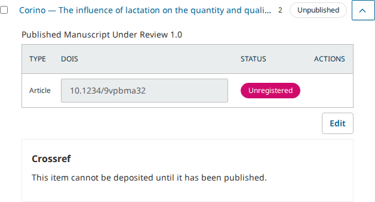
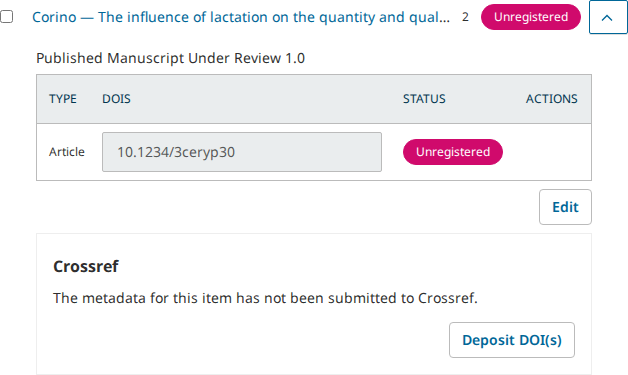
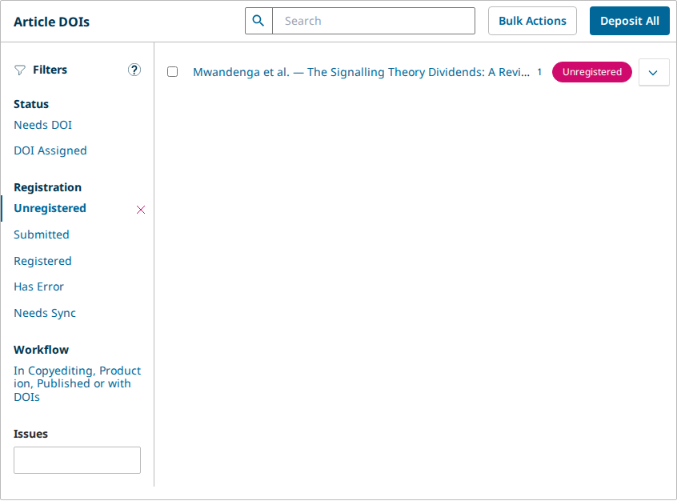
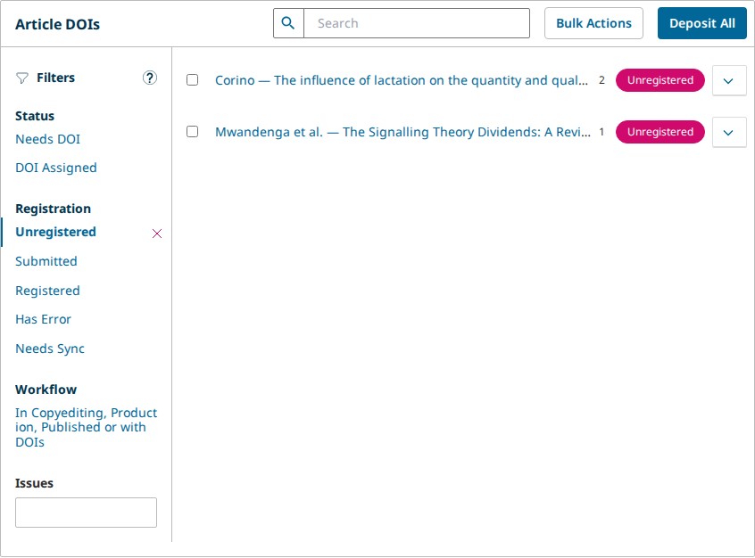
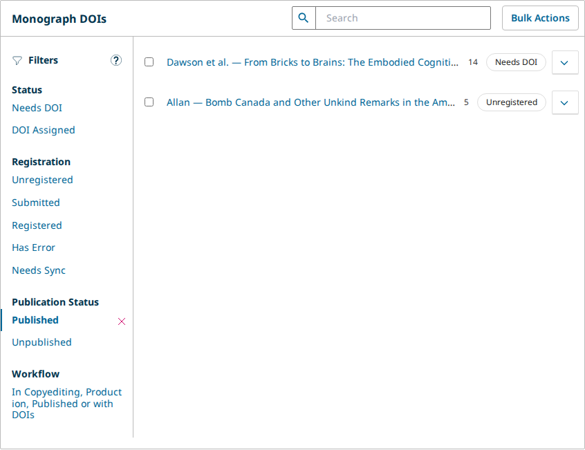
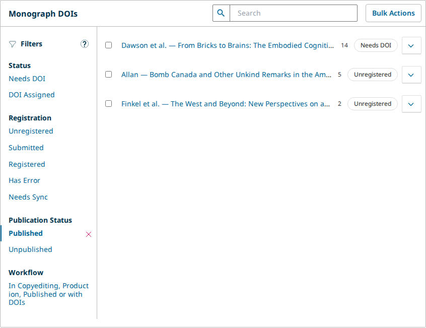

# The DOI fix treats a published "Manuscript Under Review" as published, but a press's "Publication Status" filters still list such a book as unpublished

- **Severity** low
- **Effort** small
- **Kind** intention gap (in the PRs before their merge)
- **Affects**
  - main: OMP, with the PRs (OMP has no PR of its own and takes pkp-lib and ui-library with its next pointer bump)
  - 3.5: none (code; no version stages, pkp/pkp-lib#12799 is `main` only)
  - 3.4: none (code; no version stages)
  - 3.3: none (code; no version stages)
- **Introduced** `pkp/pkp-lib#13529`, `pkp/ui-library#1017` and `pkp/ojs#5937` for `pkp/pkp-lib#13528` · open PRs, heads
  [223bface61](https://github.com/pkp/pkp-lib/pull/13529/commits/223bface61ffd56a288a9effd5621f9d4a499cfb),
  [99abe25290](https://github.com/pkp/ui-library/pull/1017/commits/99abe2529078b1cf9b8f0d7c0c67c2fce2d2e020) and
  [5eed1f391b](https://github.com/pkp/ojs/pull/5937/commits/5eed1f391b5a8767dc324b306236c54b92a259f5) ·
  2026-10-15 · Bozana Bokan (bozana)
- **Upstream** `pkp/pkp-lib#13528` (open; it lists the three PRs)
- **Tracked in** ci-triage Companion row · Temporary: delete once acted on
- **Checked** 2026-10-15, the PR heads and their bases (the commits in Evidence)
- **Model** claude-opus-5-5

## Summary

pkp-lib#13528 reports that the DOIs page treats a submission whose only
published version is a "Published Manuscript Under Review" (PMUR) as
unpublished. The badge reads "Unpublished", it cannot be deposited from
the page, and "Unregistered" leaves it out. The PRs fix all of that. With
the PRs, on PKP's default dataset, OJS's article 2 and OMP's book 2 carry
the DOI's own badge ("Unregistered") once their PMUR is published. In OJS
the Crossref box offers "Deposit DOI(s)". "Unregistered" lists both, next
to the published Version of Record that serves as the control. At the PRs'
bases, the same steps show the issue's symptoms. OPS has no PMUR stage and
reads the same at base and head.

OJS article 2 with its PMUR published, at the base and with the PRs:





"Unregistered" at the base (article 1 alone) and with the PRs (articles 2 and 1):





One thing the PRs leave: a press's own "Publication Status" filters
("Published", "Unpublished") still filter on the submission's status. So
with the PRs, OMP's book 2 has a published current version, yet "Published"
leaves it out and "Unpublished" lists it. The issue's expected result
("treated as published on the DOI management page") does not hold for
those two filters. The fix is two lines in OMP's `DoiListPanel.php`, and
it was tried.

From the tests' side the PRs are safe to merge for what they change:
nothing that worked before breaks, and the three apps' suites at the PR
refs are green.

## Impact

- **Lost**: nothing. The book can still be found through "Unregistered"
  or the search, and its DOIs can be marked or deposited.
- **Who**: press managers who publish a version below Version of Record
  and then narrow the DOIs page to "Published" works.
- **Way round**: "Unregistered" (for a book whose DOI is not yet sent),
  or the list without the filter.

Low: one filter group disagrees with the badge and the other filters on a
press, and nothing is lost.

## Steps to reproduce

On PKP's default dataset, OMP at its `main` tip with `lib/pkp` at
pkp-lib#13529 and `lib/ui-library` at ui-library#1017 (built):

1. Sign in as `dbarnes`. Settings › Distribution › "DOIs" › "Setup":
   "DOI Prefix" `10.1234`, "Save".
2. Book 2 ("The West and Beyond", at External Review with one round):
   set its version's "Publication Stage" to "Published Manuscript Under
   Review" 1.0, associate the round, and publish it. The book stays
   "Queued", as pkp/pkp-lib#12799 intends.
3. DOIs page: tick book 2 and book 5 (a published Version of Record),
   Bulk Actions › "Assign DOIs".
4. Press "Unregistered": books 5 and 2 are listed (the PRs' fix).
5. Clear it and press "Publication Status" › "Published": only books 14
   and 5 are listed. Clear it and press "Unpublished": book 2 is listed.

**Expected**: "Published" lists book 2 and "Unpublished" does not, as
the badge and "Unregistered" now treat it.

**Observed**: the reverse (step 5).



## Cause

`classes/components/listPanels/DoiListPanel.php` in OMP (and in OPS) adds
the "Publication Status" filter group with `'param' => 'status'` and the
`PKPSubmission::STATUS_*` values. The PRs move pkp-lib's "Unregistered"
filter (`publishedStatuses`) and ui-library's `getIsPublishedBase()` to
the current publication's status. These app-side filters were not part of
the PR set.

## Proposed fix

The same switch in OMP (tried, see Evidence):

```diff
--- a/classes/components/listPanels/DoiListPanel.php
+++ b/classes/components/listPanels/DoiListPanel.php
@@ -17,7 +17,7 @@
 use PKP\components\listPanels\PKPDoiListPanel;
-use PKP\submission\PKPSubmission;
+use PKP\publication\PKPPublication;
@@ -42,13 +42,13 @@
                 [
                     'title' => __('publication.status.published'),
-                    'param' => 'status',
-                    'value' => (string) PKPSubmission::STATUS_PUBLISHED
+                    'param' => 'currentPublicationStatus',
+                    'value' => (string) PKPPublication::STATUS_PUBLISHED
                 ],
                 [
                     'title' => __('publication.status.unpublished'),
-                    'param' => 'status',
-                    'value' => PKPSubmission::STATUS_QUEUED . ', ' . PKPSubmission::STATUS_SCHEDULED
+                    'param' => 'currentPublicationStatus',
+                    'value' => PKPPublication::STATUS_QUEUED . ', ' . PKPPublication::STATUS_SCHEDULED
                 ]
```

With it, "Published" lists books 14, 5 and 2 and "Unpublished" no longer
lists book 2. Nothing else changes on the default dataset.



What goes with it (team's call): a declined work that the page still
lists keeps a current version that is "Queued". So with the switch,
"Unpublished" lists it, where today neither filter does. OPS has the same
two lines. There it changes nothing for this issue, since a preprint has
only the one stage. Tried on OPS too, the same switch moves the declined
preprint 4 into "Unpublished" and leaves everything else as it was. So
OPS can stay as it is, or take the switch for consistency.

## Evidence

- PRs: pkp/pkp-lib#13529 head `223bface61ffd56a288a9effd5621f9d4a499cfb`
  on `dce15320c7` (pkp-lib's `main` tip); pkp/ui-library#1017 head
  `99abe2529078b1cf9b8f0d7c0c67c2fce2d2e020` on `dd86f760dd`
  (ui-library's `main` tip); pkp/ojs#5937 head `5eed1f391b` on
  `e591926d11` (OJS's `main` tip), a pointer bump to both heads. OMP
  `f4836d4fb` and OPS `2ece50497f` (their tips) with both submodules
  checked out at the same bases and heads. The apps' own `lib/pkp`
  pointers (`b17fadae59`) lag the base by pkp/pkp-lib#13489 (reviewed),
  #13513 (`dac423e881`, not yet read by the daily sync) and their merges.
- Base and head, OJS, OMP and OPS, PKP's default dataset (fleet
  `pr-13528`), on the VM in slot s1:
  `checks/sync/pkp-lib-13529/walk.js` run by `side.sh base|head`
  (facts `.reports/pr-13528/pr/walk-{base,head}-*.json`).
  - OJS article 2 and OMP book 2, PMUR 1.0 published through the
    publication API the publish panel calls (200, 200 at both sides);
    submission "Queued", current version published.
  - Base: badge "Unpublished"; OJS's Crossref box "This item cannot be
    deposited until it has been published." with no button;
    "Unregistered" (`status[]=3`) lists only the control (OJS 1,
    OMP 5). Bulk "Deposit DOIs" on article 2 still answers 200 and its
    DOI reads "Submitted", as the issue says.
  - Head: badge "Unregistered"; OJS's box "The metadata for this item
    has not been submitted to Crossref." with "Deposit DOI(s)";
    "Unregistered" (`currentPublicationStatus[]=3`) lists 2 and the
    control in both apps. OMP "Published" (`status=3`) lists 14, 5;
    "Unpublished" (`status=1, 5`) lists book 2 among 16.
  - OPS (control, preprint 5): the same at both sides, apart from the
    query's parameter name.
  - Trial: `bin/try-fix.js` with `fix-omp.diff` (and `fix-ops.diff`) at
    the heads, on a fresh dataset: OMP "Published" 14, 5, 2,
    "Unpublished" 15 books without 2; OPS "Unpublished" 4 (declined) and
    1, everything else unchanged.
- Read: every reader of `publishedStatuses`, `getIsPublished()` and the
  submission's status on the DOIs page (pkp-lib, ui-library, the three
  apps' `DoiListPanel.php`). OJS's "Issues" tab keeps its own
  `isPublished` filter. `pkp.const.publication` reaches every backend
  page (`PKPTemplateManager::setupBackendPage()`, merged deeply with
  OJS's additions). `filterByCurrentPublicationStatus()` joins the
  current publication, which `getCurrentPublicationIdByPublications()`
  keeps on the most mature published version. No security impact: the
  new API parameter only narrows a list the caller may already read.
- The suites: pkp-e2e CI
  [38744218510](https://github.com/jardakotesovec/pkp-e2e/actions/runs/38744218510)
  at the PR refs (OJS at ojs#5937, `pkp_lib_ref` pull/13529/head,
  `ui_library_ref` pull/1017/head, OMP and OPS at their tips): all 9 jobs green, none flaky.
