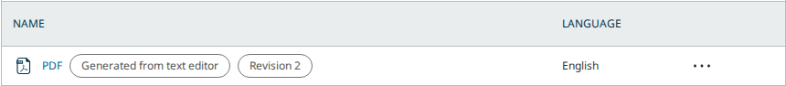
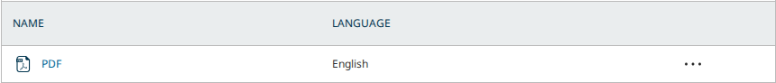
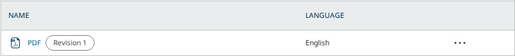

# Galleys from the Body Text (pkp-lib#13543): the conversion has no screen yet, a generated PDF takes over a hand-made galley, and the OJS lockfile breaks the Word import

- **Severity** medium (findings 1 and 2); low (3–6)
- **Effort** small each (finding 4: the missing screen, not sized)
- **Kind** PR review before the merge: two intention gaps, a regression of the Body Text import, a question, small faults
- **Affects**
  - main: OJS with the PRs (none merged yet); OMP and OPS build and run with the shared PRs and show nothing new
  - 3.5: none (code; the Body Text editor is `main` only)
  - 3.4: none (code)
  - 3.3: none (code)
- **Introduced** `pkp/pkp-lib#13545`, `pkp/ui-library#1021` and `pkp/ojs#5946` for `pkp/pkp-lib#13543` · open PRs, heads
  [c9cd7d31c4](https://github.com/pkp/pkp-lib/pull/13545/commits/c9cd7d31c439c69adc27328655c302491f712ca0),
  [936b915c56](https://github.com/pkp/ui-library/pull/1021/commits/936b915c56698a76afd2d9149f171cbeda3d5b97) and
  [87b9df9594](https://github.com/pkp/ojs/pull/5946/commits/87b9df95941d71658ba84e8199a4156eaee2d6ff) ·
  2026-10-16 · Vitaliy-1
- **Upstream** `pkp/pkp-lib#13543` (open, milestone 3.6; [the comment listing the three PRs](https://github.com/pkp/pkp-lib/issues/13543#issuecomment-6215019753))
- **Tracked in** ci-triage Companion row `13543` · Temporary: delete once acted on
- **Checked** 2026-10-16, the PR heads and their bases (the commits in Evidence)
- **Model** claude-opus-5-5

## Summary

pkp-lib#13543 asks for the Body Text editor's document to become HTML and
PDF galleys: HTML through ProseMirror's DOM serializer, PDF through
Vivliostyle in the browser, with no download and re-upload by hand. The
three PRs bring the server half: `POST …/bodyText` stores an HTML body
as an "HTML" galley, `POST …/bodyText/pdf` stores a PDF body as a "PDF"
galley, a second call adds a revision to the same galley, and the galley
list gains two badges, "Generated from text editor" and "Revision N". They
also bring the npm packages (`vivliostyle-pdf`, `prosemirror-model`), the
build plugin and the fonts. Driven on PKP's default dataset in OJS at the
heads and the bases, the endpoints do what the PR says. Authors are
refused, a body that is not a PDF gets 400 and a wrong content type 415.

| # | Finding | Severity | Effort |
|---|---|---|---|
| 1 | Generating takes over a hand-made galley labelled "PDF" or "HTML": its file is replaced and it is relabelled "Generated from text editor" | medium | small |
| 2 | The OJS lockfile nests two more copies of `prosemirror-model`, so a Word file sent to the Body Text loses its heading (U48 S2 red) | medium | small |
| 3 | ❓ "Revision 1" shows on every galley whose file was changed by hand (U46 S1 red) | low | small |
| 4 | No screen calls the conversion: nothing imports Vivliostyle or the new serializer, and 12 new texts are unused | low | not sized |
| 5 | The refusals read "The {$param} parameter contains an invalid value." | low | small |
| 6 | A refused or failed save leaves the stored file behind (read in the code, not driven) | low | small |

A generated galley also lands on a published version: the PDF readers
download is swapped and a new HTML galley shows at once. That is not a
finding. The Galleys page already works that way on a published version
(U46 Rule 10: "Every change reaches readers at once"), and a
regenerated HTML file reaches signed-out readers up to a day late
there too (U46 OJS3, the HTML galley plugin's cache).

The PR's own e2e check on pkp/ojs#5946 is red on U46 S1 and U48 S2. Both
reds reproduce locally at the heads, are green at the bases, and both
are the PRs' doing: U48 S2 is finding 2 (green 9 of 9 with the fix
tried), and U46 S1 is finding 3. The three apps' suites at the PR
heads on pkp-e2e's CI show those two reds and nothing else: OMP and OPS
are green.

From the tests' side the PRs are not ready to merge: finding 1 swaps
an editor's own galley file, and finding 2 breaks an existing import
and would keep every OJS PR check red once the lockfile lands. The
merge is the team's call. Asked of the author, before the merge: the
fixes under findings 1 and 2, the answer to 3, and the commit with the
screen (finding 4) if it was meant to be part of these PRs.

## Impact

- **Lost**: with finding 1, an editor's own PDF galley stops serving the
  editor's file; on a published version the readers' download changes
  with it. The old file is kept as a revision, but no screen brings it
  back. With finding 2, a Word file sent to the Body Text arrives with
  its first heading marked unconverted.
- **Who**: journal editors and managers who use the Body Text (OJS
  `main`), and the readers of their articles.
- **Frequency**: every generation on a version whose galleys use the
  labels "PDF" or "HTML", the usual naming (1), and every Word import
  with a heading (2).

## Finding 1: generating takes over a hand-made galley

### Steps to reproduce

From PKP's default dataset, OJS, with the PRs, as `dbarnes`:

1. Article 9 ("Hansen & Pinto: Reason Reclaimed", Production), its
   "Galleys" page: "Add galley", label "PDF", upload a PDF.
2. `POST …/submissions/9/publications/10/bodyText/pdf` with a PDF body.
3. Reload "Galleys".

**Expected**: the generated PDF gets its own galley; the editor's own
"PDF" keeps its file.

**Actual**: no new galley. The editor's galley now serves the generated
file and is marked "Generated from text editor", and the editor's own
file is a revision behind it. On article 17, published, the same call
swapped the PDF its readers download (14,572 bytes before, the
generated 193 bytes after).



### Cause

`Repository::createGalleyFile()` looks for a galley to revise by label
(`'PDF'` or `'HTML'`), locale, no remote URL and the file's MIME type.
It never checks `generatedFrom`, so the first hand-made galley with that
label matches.

### Proposed fix

Revise only a galley the editor generated (not tried):

```php
if ($galley->getData('generatedFrom') !== Representation::GENERATED_FROM_EDITOR
    || $galley->getData('label') !== $label || $galley->getData('locale') !== $locale || $galley->getData('urlRemote')) {
    continue;
}
```

## Finding 2: the OJS lockfile breaks the Word import (U48 S2)

### Steps to reproduce

From PKP's default dataset, OJS, built from pkp/ojs#5946 with `npm ci`:

1. As `dbarnes`, a submission with a Word file holding a heading in
   "Submission Files": "Send to Text Editor", choose the version,
   "Confirm".

**Expected** (at the base, and with the fix below): the box steps through "Downloading
document…", "Loading converter…", "Converting…" and goes, and the
heading arrives in the editor.

**Actual**: the box ends on "Imported with warnings: 1 part(s) of the
document need attention. Unconverted blocks are marked in the document.
Could not render Pandoc node Header". The console logs
`[documentImport] warnings` with that error for the `Header` block.

### Cause

At the PR head the lockfile holds three copies of `prosemirror-model`
1.25.8: the root one, plus one nested under `@sciflow/pandoc-ast` and one
under `@sciflow/schema-prosemirror`. At the base there is only the root
copy. Vite bundles each copy as a module of its own, so the document
that `@sciflow/pandoc-ast` builds fails the schema checks of the
editor's copy. The nesting probably comes from the root pin: ui-library
pins `prosemirror-model` at `1.25.4`, OJS at `1.25.8`.

### Proposed fix

Tried: removing the two nested entries from `package-lock.json` (18
lines, `npm ci`, build). U48 went green 9 of 9, S2 included. Keep one
copy: pin the same `prosemirror-model` version in ui-library's and
OJS's `package.json` (the editor's 1.25.8) and regenerate the lockfile,
then check that `npm ls prosemirror-model` shows one copy, deduped.

## Finding 3: ❓ "Revision 1" on a galley changed by hand (U46 S1)

With the PRs, "Change File" on any galley adds "Revision 1" to its name
cell. The galley list's revision badge counts the file's revisions,
whatever made them, so a hand-made "PDF" whose file was replaced once
reads "PDF Revision 1".





The question for the author: is the badge meant for every galley, or
only for those the editor generated (the issue is about the latter)?
Either answer is fine for the tests:

- **For every galley**: U46 S1 reads a row by its whole name cell and
  needs to read the label alone. That is a test change on the companion
  branch, made once the answer is in.
- **Generated only**: `classes/galley/maps/Schema.php` returns
  `revisionLabel` only when `generatedFrom` is `editor`, and U46 stays as
  it is.

A smaller point either way: "Revision 1" shows on the file's second
version. The map runs a revisions query per galley wherever galleys are
mapped (`apiSummary`), the submission lists included.

## Finding 4: no screen calls the conversion

The issue's flow (the Body Text's HTML through `DOMSerializer`, a PDF
through Vivliostyle, saved as galleys) is not reachable from any screen
with these PRs:

- `editorDocumentToHTML()` (ui-library `useBodyTextEditor.js`) has no
  caller; `vivliostyle-pdf` is a dependency nothing imports. The built
  OJS bundle holds no Vivliostyle code, and the `vivliostyleCompat()`
  build plugin finds nothing to transform.
- 12 texts are new and named by nothing: `publication.bodyText.exportToHTML`,
  `.exportedToHTML`, `.pdf.preview`, `.pdf.publication`, `.pdf.generate`,
  `.pdf.generating`, `.pdf.ready`, `.pdf.saving`, `.pdf.galleyCreated`,
  `.pdf.failed`, `api.bodyText.500.errorCreatingHtmlFile`,
  `api.bodyText.500.errorCreatingPdfGalley`.
- The build copies Vivliostyle's fonts (4.4 MB) into `js/build/vivliostyle-pdf/`.

The second ui-library commit ("Resolve PDF conversion error") reads like
one from a branch that does run the conversion. The author may not have
pushed the commit holding the Body Text buttons yet. Without it, only
the endpoints and the badges can be reviewed, and that is what this
review covers.

## Finding 5: the refusals show a placeholder

A PDF body that is not a PDF (400) and an HTML body sent as JSON (415)
both answer "The {$param} parameter contains an invalid value.":
`api.400.invalidValue` is called without its `param`. The 422 branch
passes `['message' => …]` to `api.422.routeRequestUnableToProcess`, whose
text has no `{$message}`, so the cause is dropped. The two new
`api.bodyText.500.*` texts fit these branches. Fix: use them, or pass
`param` (not tried).

## Finding 6: a failed save leaves its file behind (code only, not driven)

`createGalleyFile()` stores the content (`addFromString`) before the
transaction. When a validation inside the transaction throws, the
exception leaves the method, and the cleanup `if (!$galleyId)` never
runs (the closure returns an id or throws). The file stays in `files`
and on disk with nothing pointing at it. Fix: wrap the transaction in a
`try`/`catch` that deletes `$fileId` and rethrows (not tried).

## Evidence

- **Heads**: ojs `87b9df95941d71658ba84e8199a4156eaee2d6ff`, lib/pkp
  `c9cd7d31c439c69adc27328655c302491f712ca0`, lib/ui-library
  `936b915c56698a76afd2d9149f171cbeda3d5b97`; OMP `9f4393633e` and OPS
  `1bfe77fcd8` at their tips with both shared heads in their submodules.
  The heads are based on the tips (pkp-lib `6ff76591a9`, ui-library
  `9cfb898731`, ojs `79c3676d1b`) and carry no unreviewed tip commit.
- **Bases**: ojs `79c3676d1b91e033e313e454b2d3c4ef17618963`, lib/pkp
  `6ff76591a99d08c8bf5a160fdec0f3a5c711dc64`, lib/ui-library
  `9cfb898731e5afbfa13932f27056c5d1ac2f6fb2`.
- **Walk**: `shared/playwright/checks/sync/pkp-lib-13545/walk.js` via
  `side.sh base|head` on dataset fleet 1, freshly reset. It records
  absence, so the same script runs on both sides. At the base every
  POST answers 500 ("The POST method is not supported for route …" and
  "The route …/bodyText/pdf could not be found."), no galley changes,
  the cell after "Change File" reads "PDF" and article 17's PDF stays
  14,572 bytes. At the head: A1–A3 201 (HTML galley 4, then "Revision
  1"; PDF galley 5), A4 400, A5 415, B2 201 on the hand-made galley 6
  ("Revision 2"), C1 and C2 201 on published publication 18 (reader's
  PDF 193 bytes, the generated one; new HTML galley 7), D1 the author
  `vkarbasizaed` 401 `user.authorization.roleBasedAccessDenied`. The
  dataset's galleys are unapproved already (`is_approved` 0) and readers
  get them, so the PRs' `isApproved: false` changes nothing a reader sees.
- **The PR's own check**: pkp/ojs run 38909281219, job 1/3: U46 S1
  (`galleys.row('PDF')` not found after "Change File") and U48 S2 (the
  import poll times out), each red on its retry too. Reproduced locally
  at the heads (`--retries=0`): both red. U48 with finding 2's fix:
  9 passed. At the bases, on the same database: both green.
- **Suites**: pkp-e2e run
  [38932643155](https://github.com/jardakotesovec/pkp-e2e/actions/runs/38932643155),
  OJS at the PR head, OMP and OPS at their tips, pkp-lib and ui-library
  pinned at the heads: OJS red on U46 S1 and U48 S2 alone, OMP and OPS
  green (OMP U28 S15 flaky, a known flake class).
- **Builds**: OJS (`npm ci` from the PR's lockfile), OMP and OPS with
  the shared heads all build. OMP and OPS lack `vivliostyle-pdf` and
  `prosemirror-model` in their own `package.json` and need neither while
  nothing imports them.
- **Security**: none routed. The new endpoints admit the roles that can
  already upload galleys (an author gets 401), and an HTML galley built
  from an editor's body is no more trusted than one the editor uploads.
